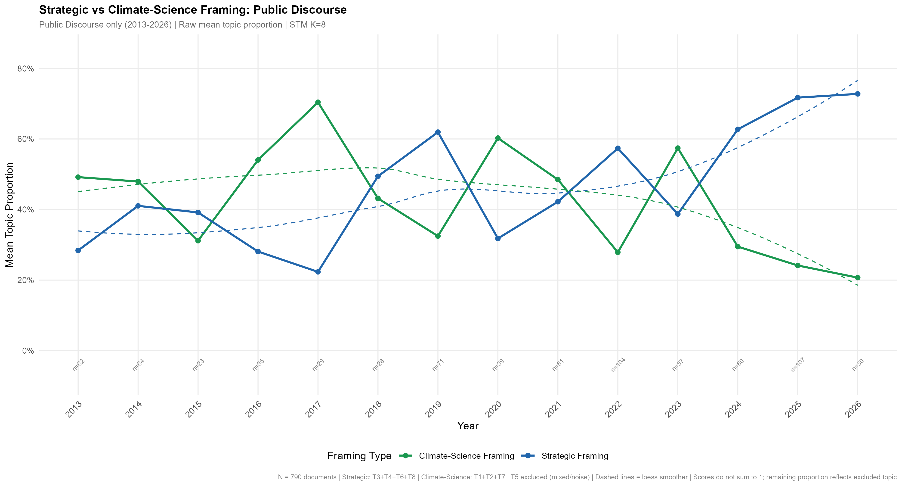

# India and the Changing Meaning of the Arctic: Structural Topic Modelling of Indian Arctic Discourse

Code for the computational analysis in my MSc thesis *India and the changing meaning of the Arctic* (Advanced MSc International Relations and Diplomacy, Leiden University, 2026; supervisor Dr. Nicolas Blarel).

## Research question

How have changes in the geopolitical environment influenced the framing of the Arctic in Indian discourse from 2013 to early 2026, and how does this framing differ between official government and public registers?

## What this repository does

The pipeline in `analysis/stm_analysis.Rmd` takes raw Nexis Uni exports and produces the framing trajectories reported in the thesis:

1. **Corpus construction**: loads three document sets, removes cross-folder duplicates and merges them.
2. **Metadata extraction**: parses publication date and source name from the Nexis document structure with regular expressions, and classifies each document as Government or Public Discourse.
3. **Cleaning**: extracts body text between the `Body` and `Classification` markers, inspects short documents and applies a 100-word minimum length threshold.
4. **Preprocessing**: a reusable function that tokenises, removes standard and corpus-specific stopwords, stems, trims rare terms and converts to STM format.
5. **Modelling**: structural topic models with year as a prevalence covariate, run separately on the full corpus (2008-2026, K=8), public discourse (2013-2026, K=8) and government documents (2013-2026, K=3). K is selected with `searchK` diagnostics.
6. **Framing scores**: topics are grouped into strategic and climate-science framings, and yearly mean proportions are plotted with document counts per year.
7. **Inference over time**: `estimateEffect` tests whether topic prevalence changes significantly over time.
8. **Validation**: theory-driven dictionaries are correlated with STM framing scores as an external check on topic interpretation.

## Corpus

| Subcorpus | Period | Documents | Role |
|---|---|---|---|
| Full corpus | 2008-2026 | 920 | Overall trajectory (2008-2012 as pre-observer context) |
| Public discourse | 2013-2026 | 790 | STM-based temporal framing analysis |
| Government | 2013-2026 | 53 | Qualitative content analysis; STM shown as a robustness check |

## Key finding

Strategic framing of the Arctic rises sharply in Indian public discourse (from roughly a third of topic share in 2013 to around three quarters by early 2026, crossing climate-science framing around 2021-2022), while official discourse stays largely in a cooperative and scientific register. The gap between the two registers widens over time.



## Repository structure

```
.
├── analysis/
│   └── stm_analysis.Rmd     # full pipeline, from raw exports to figures
├── data/
│   ├── README.md            # data source, search query, expected folder layout
│   └── raw/                 # not tracked (licensed content)
├── figures/                 # output figures
└── india-arctic-framing-stm.Rproj
```

## Data availability

The raw documents were retrieved from Nexis Uni under an institutional licence and **cannot be redistributed**. The full Boolean search query, filters and expected folder layout are documented in [`data/README.md`](data/README.md), so the corpus can be rebuilt by anyone with Nexis Uni access.

## How to reproduce

1. Clone the repository and open `india-arctic-framing-stm.Rproj` in RStudio.
2. Rebuild the corpus following `data/README.md` and place the exports in `data/raw/`.
3. Install the required packages:
   ```r
   install.packages(c("here", "quanteda", "readtext", "quanteda.textstats",
                      "quanteda.textplots", "stm", "stringr", "tidyverse", "scales"))
   ```
4. Knit `analysis/stm_analysis.Rmd`. Figures are written to `figures/`. Package versions used are listed in the session info at the end of the knitted output.

Random seeds are fixed (`set.seed(123)`) for `searchK` and `stm`.

## Known limitations of the code

Documented here for transparency; the code is kept as used for the submitted thesis so that results reproduce exactly.

- Some custom stopwords are written in stemmed form (for example `minist`, `countri`, `govern`) but are removed before stemming, so they only match tokens that are literally spelled that way.
- `dfm_lookup()` is applied to a unigram document-feature matrix, so multi-word dictionary entries (for example `"sea ice"`, `"northern sea route"`) do not match. Applying `tokens_lookup()` to tokens would capture them.

## Author

Akanksha Singh
