Arctic Framing in Indian Discourse: STM Analysis
================
Akanksha Singh
2026

This notebook reproduces the computational part of the MSc thesis *India
and the changing meaning of the Arctic* (Leiden University, 2026):
corpus construction from Nexis Uni exports, metadata extraction, text
cleaning, structural topic models for three subcorpora, framing
trajectories over time, and dictionary validation of the STM framing
scores. See the repository README for context and `data/README.md` for
data access.

## 1. Load Packages

``` r
library(here)
library(quanteda)
library(readtext)
library(quanteda.textstats)
library(quanteda.textplots)
library(stm)
library(stringr)
library(tidyverse)
library(scales)

# Output folder for saved figures
dir.create(here("figures"), showWarnings = FALSE)
```

------------------------------------------------------------------------

## 2. Load and Merge Data

``` r
# Load three separate document folders (see data/README.md for expected layout)
gov_2013_2026  <- readtext(here("data", "raw", "gov_2013_2026", "*"),  encoding = "utf-8")
full_2013_2026 <- readtext(here("data", "raw", "full_2013_2026", "*"), encoding = "utf-8")
full_2008_2012 <- readtext(here("data", "raw", "full_2008_2012", "*"), encoding = "utf-8")

# Remove duplicates from full corpus, keeping the government folder as authoritative
full_2013_2026_clean <- full_2013_2026 %>%
  filter(!doc_id %in% gov_2013_2026$doc_id)

# Merge all three into one dataset and rename doc_id
Arctic_IND_fr <- bind_rows(
  gov_2013_2026,
  full_2013_2026_clean,
  full_2008_2012
) %>%
  rename(Title = doc_id)

# Confirm merge
cat("Total documents loaded:", nrow(Arctic_IND_fr), "\n")
```

    ## Total documents loaded: 935

``` r
cat("Duplicate titles remaining:", sum(duplicated(Arctic_IND_fr$Title)), "\n")
```

    ## Duplicate titles remaining: 0

------------------------------------------------------------------------

## 3. Extract Metadata

``` r
# Extract publication date and year from Load-Date field
Arctic_IND_fr <- Arctic_IND_fr %>%
  mutate(
    load_date = str_extract(text, "(?i)load-date:\\s*([A-Za-z]+ \\d{1,2},\\s*\\d{4})") %>%
      str_remove("(?i)load-date:\\s*") %>%
      as.Date(format = "%B %d, %Y"),
    year = as.integer(format(load_date, "%Y"))
  )
```

``` r
# Extract source name using publication date line as anchor
# and classify into Government or Public Discourse
Arctic_IND_fr <- Arctic_IND_fr %>%
  mutate(
    source_name = sapply(text, function(x) {

      # Isolate text above "Body" section only
      body_idx <- regexpr("\\bBody\\b", x)
      if (body_idx > 0) x <- substr(x, 1, body_idx - 1)

      lines <- str_trim(str_split(x, "\n")[[1]])

      # Pattern 1: full date "Month D, YYYY" with optional weekday and time
      date_line_idx <- which(str_detect(lines,
        "^(January|February|March|April|May|June|July|August|September|October|November|December)\\s+\\d{1,2},\\s+\\d{4}"))

      # Pattern 2: month and year only "Month YYYY" (fallback)
      if (length(date_line_idx) == 0) {
        date_line_idx <- which(str_detect(lines,
          "^(January|February|March|April|May|June|July|August|September|October|November|December)\\s+\\d{4}$"))
      }

      # Return line immediately above first date match
      if (length(date_line_idx) > 0) {
        idx <- date_line_idx[1]
        for (i in (idx - 1):1) {
          if (nchar(lines[i]) > 0) return(lines[i])
        }
      }

      return(NA_character_)
    }),

    # Classify source type
    source_type = case_when(
      source_name %in% c(
        "Indian Government News",
        "IPR",
        "Government of India Ministry of External Affairs - Press Releases",
        "Government Initiated campaigns",
        "Government of India Ministry of External Affairs - Speeches & Statements",
        "Indian Parliament Q&A",
        "Government of India Ministry of External Affairs - Media Briefings"
      ) ~ "Government",
      is.na(source_name) ~ NA_character_,
      TRUE ~ "Public Discourse"
    )
  )

# Verify extraction
cat("Year distribution:\n")
```

    ## Year distribution:

``` r
print(table(Arctic_IND_fr$year, useNA = "always"))
```

    ## 
    ## 2008 2009 2010 2011 2012 2013 2014 2015 2016 2017 2018 2019 2020 2021 2022 2023 
    ##   10    4   10   31   22   67   67   24   36   33   31   76   43   87  113   64 
    ## 2024 2025 2026 <NA> 
    ##   68  112   37    0

``` r
cat("\nSource type distribution:\n")
```

    ## 
    ## Source type distribution:

``` r
print(table(Arctic_IND_fr$source_type, useNA = "always"))
```

    ## 
    ##       Government Public Discourse             <NA> 
    ##               56              879                0

------------------------------------------------------------------------

## 4. Clean Text and Filter Corpus

``` r
# Extract body text only: content between "Body" and "Classification" markers
# (?s) flag allows matching across line breaks
Arctic_IND_fr <- Arctic_IND_fr %>%
  mutate(
    text_clean = str_extract(text, "(?s)(?<=\\bBody\\b).*?(?=\\bClassification\\b)") %>%
      str_trim(),
    doc_length = str_count(text_clean, "\\w+")
  )

cat("Documents with extracted body text:", sum(!is.na(Arctic_IND_fr$text_clean)), "\n")
```

    ## Documents with extracted body text: 935

``` r
cat("Documents with empty body text:",
    sum(nchar(trimws(Arctic_IND_fr$text_clean)) == 0, na.rm = TRUE), "\n")
```

    ## Documents with empty body text: 0

``` r
cat("\nBody text length summary:\n")
```

    ## 
    ## Body text length summary:

``` r
print(summary(Arctic_IND_fr$doc_length))
```

    ##    Min. 1st Qu.  Median    Mean 3rd Qu.    Max. 
    ##    39.0   348.0   497.0   603.3   755.0  4408.0

``` r
# Check document counts across different word count thresholds
# to determine appropriate minimum length cutoff
cat("Documents under 100 words:", sum(Arctic_IND_fr$doc_length < 100), "\n")
```

    ## Documents under 100 words: 15

``` r
cat("Documents under 150 words:", sum(Arctic_IND_fr$doc_length < 150), "\n")
```

    ## Documents under 150 words: 37

``` r
cat("Documents under 200 words:", sum(Arctic_IND_fr$doc_length < 200), "\n")
```

    ## Documents under 200 words: 74

``` r
# Inspect documents under 200 words before deciding threshold
Arctic_IND_fr %>%
  filter(doc_length < 200) %>%
  select(Title, source_type, year, doc_length) %>%
  arrange(doc_length) %>%
  print(n = Inf)
```

    ## readtext object consisting of 74 documents and 2 docvars.
    ## # A data frame: 74 × 5
    ##    Title                                      source_type  year doc_length text 
    ##    <chr>                                      <chr>       <int>      <int> <chr>
    ##  1 Climate Change prompts $12.7m upgrade to … Public Dis…  2018         39 "\"\…
    ##  2 Prospects for India - Russia cooperation … Public Dis…  2026         50 "\"\…
    ##  3 Union Minister Jitendra Singh unveils Arc… Public Dis…  2022         65 "\"\…
    ##  4 India To Unlock Arctic Mysteries Now Afte… Public Dis…  2024         76 "\"\…
    ##  5 GOVERNMENT TO SET UP MARINE OBSERVATION S… Public Dis…  2018         85 "\"\…
    ##  6 AC adds 6 Nations as Observer States.PDF   Public Dis…  2013         87 "\"\…
    ##  7 India , Russia discuss maritime cooperati… Public Dis…  2023         87 "\"\…
    ##  8 India , China must have say in Arctic_ Ic… Public Dis…  2013         90 "\"\…
    ##  9 India Climate Summit 2024_ India 's Role … Public Dis…  2024         91 "\"\…
    ## 10 Kufos faculty to develop course on Arctic… Public Dis…  2023         91 "\"\…
    ## 11 Russia to launch first satellite to monit… Public Dis…  2020         93 "\"\…
    ## 12 Dharmendra Pradhan to hold talks with Rus… Public Dis…  2019         94 "\"\…
    ## 13 Norway sued by environmentalists over Arc… Public Dis…  2017         94 "\"\…
    ## 14 Ministry of Earth Science_ Membership of … Public Dis…  2013         97 "\"\…
    ## 15 Vladimir Putin _ Climate change in Arctic… Public Dis…  2017         98 "\"\…
    ## 16 Finland _ Minister of State Kaur visits F… Public Dis…  2013        108 "\"\…
    ## 17 Russian Federation _ India has no plans t… Public Dis…  2024        111 "\"\…
    ## 18 Green Arctic_.PDF                          Public Dis…  2013        114 "\"\…
    ## 19 Sweden decides to formally apply to join … Public Dis…  2022        119 "\"\…
    ## 20 Norway welcomes India in Arctic Council.P… Public Dis…  2013        121 "\"\…
    ## 21 Expensive ship for polar research.PDF      Public Dis…  2014        123 "\"\…
    ## 22 OVL to bid for stake in gas field in Russ… Public Dis…  2011        124 "\"\…
    ## 23 Former President of Iceland , Mr Olafur R… Government   2020        126 "\"\…
    ## 24 Duma Okays Relos Pact Ahead of Putin's Vi… Public Dis…  2025        126 "\"\…
    ## 25 India 's Oil & Natural Gas Corporation Bi… Public Dis…  2010        128 "\"\…
    ## 26 ONGC Videsh to invest US$ 1 billion in of… Public Dis…  2022        132 "\"\…
    ## 27 ONGC eyeing stake in Russia 's Arctic Oce… Public Dis…  2012        132 "\"\…
    ## 28 Lukoil Develops New Technology for Oil Sp… Public Dis…  2017        135 "\"\…
    ## 29 India _ Purchase of Tanker Ships.PDF       Public Dis…  2016        136 "\"\…
    ## 30 Plans afoot to raise Russian energy secto… Public Dis…  2022        137 "\"\…
    ## 31 India , Russian Federation _ RUSSIA and I… Public Dis…  2014        138 "\"\…
    ## 32 Thrustmaster bags Arctic PSV gig.PDF       Public Dis…  2011        138 "\"\…
    ## 33 India Taps Oil, NatGas in Russian Arctic.… Public Dis…  2022        145 "\"\…
    ## 34 India to set up 12 more nuclear power sta… Public Dis…  2019        145 "\"\…
    ## 35 Rosneft gets approval for Arctic buys.PDF  Public Dis…  2011        145 "\"\…
    ## 36 Russian Federation _ India may become a s… Public Dis…  2023        146 "\"\…
    ## 37 Arctic on thin ice.PDF                     Public Dis…  2014        149 "\"\…
    ## 38 UGC to conduct national webinar on India … Public Dis…  2022        150 "\"\…
    ## 39 Russia _ The Indian authorities see great… Public Dis…  2024        152 "\"\…
    ## 40 Russia files piracy charges against Green… Public Dis…  2013        153 "\"\…
    ## 41 OVL eyes stake in Russia 's Arctic oil an… Public Dis…  2012        155 "\"\…
    ## 42 India attains Observer Status in IASC.PDF  Public Dis…  2013        156 "\"\…
    ## 43 ONGC interested in Arctic offshore explor… Public Dis…  2013        156 "\"\…
    ## 44 Oil and Natural Gas Corporation Likely to… Public Dis…  2011        160 "\"\…
    ## 45 Cabinet approves Memorandum of Understand… Government   2020        164 "\"\…
    ## 46 Former Iceland President Grimsson calls o… Public Dis…  2020        166 "\"\…
    ## 47 Dr Harsh Vardhan shares India 's vision f… Public Dis…  2021        167 "\"\…
    ## 48 Shell in talk with Rosneft for Arctic exp… Public Dis…  2011        167 "\"\…
    ## 49 India can be observer of Arctic Council_ … Public Dis…  2011        169 "\"\…
    ## 50 Air pressure change in Arctic causing fog… Public Dis…  2019        171 "\"\…
    ## 51 NASA's IceBridge wraps up 2017 Arctic cam… Public Dis…  2017        172 "\"\…
    ## 52 Norway to explore Barents and Arctic sea … Public Dis…  2011        173 "\"\…
    ## 53 Prez to visit Norway , Finland from Oct 1… Public Dis…  2014        174 "\"\…
    ## 54 Canadian Foreign Affairs Minister to part… Public Dis…  2017        176 "\"\…
    ## 55 Canada's military discovers evidence of C… Public Dis…  2023        180 "\"\…
    ## 56 RRI joins India ’s first winter expeditio… Public Dis…  2023        181 "\"\…
    ## 57 Study_ Warming in Arctic region triggerin… Public Dis…  2021        181 "\"\…
    ## 58 Shri Dharmendra Pradhan today reviewed oi… Government   2019        182 "\"\…
    ## 59 Greenpeace halts oil drilling in the arct… Public Dis…  2011        182 "\"\…
    ## 60 First time_ One person won't head MoES mi… Public Dis…  2023        183 "\"\…
    ## 61 Rosneft 'to map Arctic blocks'.PDF         Public Dis…  2011        184 "\"\…
    ## 62 Chase Christie Joins Arctic Solar Venture… Public Dis…  2016        188 "\"\…
    ## 63 In a first, science & tech mantri won't h… Public Dis…  2023        189 "\"\…
    ## 64 India Russia consultations on United Nati… Government   2022        190 "\"\…
    ## 65 Pranab to be first Indian prez to cross A… Public Dis…  2014        193 "\"\…
    ## 66 Glaciers retreating but rate falling_ Pro… Public Dis…  2020        194 "\"\…
    ## 67 UK in talks with NATO to counter Russia ,… Public Dis…  2026        194 "\"\…
    ## 68 Government of Canada_ Canada Takes Princi… Public Dis…  2014        196 "\"\…
    ## 69 US senators introduce Arctic drilling ban… Public Dis…  2019        196 "\"\…
    ## 70 Oil and Natural Gas Corporation Limited B… Public Dis…  2010        196 "\"\…
    ## 71 Statoil inks Arctic exploration deal with… Public Dis…  2012        196 "\"\…
    ## 72 ONGC Videsh Ltd Plans $1 Billion Investme… Public Dis…  2022        197 "\"\…
    ## 73 Conference discusses Asia's interest in t… Public Dis…  2014        198 "\"\…
    ## 74 Temperature hits 100 F degrees in Arctic … Public Dis…  2020        198 "\"\…

``` r
# Documents under 100 words are too short to carry reliable topic signal.
# Documents between 100 and 200 words include substantively relevant short items
# such as parliamentary questions, brief official statements and short news
# briefs; removing these would unnecessarily reduce the government corpus.
# Threshold set at 100 words based on inspection above.

Arctic_IND_fr <- Arctic_IND_fr %>%
  filter(doc_length >= 100)

cat("Final corpus after length filter:", nrow(Arctic_IND_fr), "\n")
```

    ## Final corpus after length filter: 920

``` r
cat("\nSource type distribution:\n")
```

    ## 
    ## Source type distribution:

``` r
print(table(Arctic_IND_fr$source_type, useNA = "always"))
```

    ## 
    ##       Government Public Discourse             <NA> 
    ##               56              864                0

------------------------------------------------------------------------

## 5. Define Subcorpora

``` r
# Full corpus: 2008-2026 (government + public discourse)
corpus_full <- Arctic_IND_fr

# Public discourse only: 2013-2026
corpus_pub <- Arctic_IND_fr %>%
  filter(source_type == "Public Discourse", year >= 2013)

# Government only: 2013-2026
corpus_gov <- Arctic_IND_fr %>%
  filter(source_type == "Government", year >= 2013)

cat("Full corpus (2008-2026):", nrow(corpus_full), "documents\n")
```

    ## Full corpus (2008-2026): 920 documents

``` r
cat("Public Discourse (2013-2026):", nrow(corpus_pub), "documents\n")
```

    ## Public Discourse (2013-2026): 790 documents

``` r
cat("Government (2013-2026):", nrow(corpus_gov), "documents\n")
```

    ## Government (2013-2026): 53 documents

------------------------------------------------------------------------

## 6. Preprocessing Function

``` r
# Custom stopwords
custom_stops <- c(
  # Corpus-specific constants
  "india", "indian", "arctic",
  # Neutral dateline cities
  "new", "delhi", "london", "washington", "brussels", "geneva",
  # Generic function words
  "also", "one", "can", "will", "would", "like", "use", "used",
  "using", "make", "made", "take", "said", "say", "says", "year",
  "years", "first", "second", "third", "two", "three",
  # Titles and abbreviations
  "mr", "ms", "dr", "km", "per", "cent", "rs",
  # Political titles (do not add framing signal)
  "prime", "minist", "modi", "minister", "ministri", "countri",
  "country", "nation", "state", "govern", "presid",
  "president", "leader", "offici", "official",
  "meet", "visit", "discuss", "held", "told", "spoke",
  # Noise vocabulary from environmental activism cluster
  "greenpeac", "shell", "protest", "activist", "spill",
  "drill", "rig", "corpor", "quarter", "earn", "revenu",
  "ebitda", "upsc", "papua", "guinea", "wildfir", "displac"
)

# Preprocessing function: takes a dataframe, returns DFM and STM-ready objects
preprocess_corpus <- function(data, text_field = "text_clean") {

  corp <- corpus(data, text_field = text_field)

  # Unstemmed tokens, used for dictionary validation
  toks_raw <- tokens(corp,
                     remove_punct   = TRUE,
                     remove_numbers = TRUE,
                     remove_url     = TRUE,
                     remove_symbols = TRUE) %>%
    tokens_tolower() %>%
    tokens_remove(pattern = stopwords("en")) %>%
    tokens_remove(pattern = custom_stops) %>%
    tokens_remove(pattern = phrase(c("new delhi", "united nations",
                                     "press release", "end document")))

  # Stemmed tokens, used for STM
  toks_stemmed <- toks_raw %>% tokens_wordstem()

  # DFM from stemmed tokens
  dfm_out <- dfm(toks_stemmed) %>%
    dfm_trim(min_termfreq = 3, min_docfreq = 2,
             termfreq_type = "count", docfreq_type = "count")

  # Convert to STM format
  stm_out <- convert(dfm_out, to = "stm")

  list(
    corpus    = corp,
    toks_raw  = toks_raw,
    dfm       = dfm_out,
    stm_input = stm_out
  )
}
```

------------------------------------------------------------------------

## 7. STM: Full Corpus (2008-2026)

### 7.1 Preprocess and SearchK

``` r
prep_full <- preprocess_corpus(corpus_full)
year_full <- corpus_full$year

cat("Full corpus DFM dimensions:", dim(prep_full$dfm), "\n")
```

    ## Full corpus DFM dimensions: 920 6517

``` r
# SearchK to identify optimal number of topics
set.seed(123)
searchk_full <- searchK(
  documents  = prep_full$stm_input$documents,
  vocab      = prep_full$stm_input$vocab,
  K          = c(6, 8, 10, 12, 15),
  prevalence = ~ year_full,
  data       = prep_full$stm_input$meta,
  init.type  = "Spectral",
  verbose    = FALSE
)

plot(searchk_full)
```

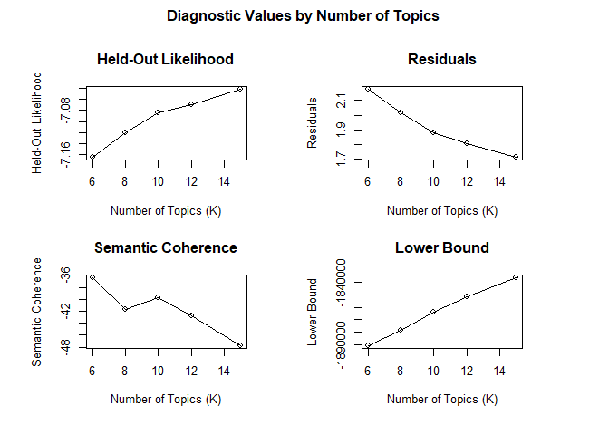<!-- -->

``` r
# SearchK results as readable table
data.frame(
  K        = unlist(searchk_full$results$K),
  semcoh   = round(unlist(searchk_full$results$semcoh), 3),
  heldout  = round(unlist(searchk_full$results$heldout), 3),
  residual = round(unlist(searchk_full$results$residual), 3)
)
```

    ##    K  semcoh heldout residual
    ## 1  6 -36.430  -7.164    2.176
    ## 2  8 -41.775  -7.120    2.018
    ## 3 10 -39.700  -7.084    1.884
    ## 4 12 -42.705  -7.070    1.806
    ## 5 15 -47.746  -7.042    1.716

### 7.2 Run STM Model

``` r
# K = 8 selected: semantic coherence peaks at K = 6 and 8 and declines from K = 10;
# K = 8 preserves theoretically meaningful distinctions
set.seed(123)
stm_full <- stm(
  documents  = prep_full$stm_input$documents,
  vocab      = prep_full$stm_input$vocab,
  K          = 8,
  prevalence = ~ year_full,
  max.em.its = 100,
  data       = prep_full$stm_input$meta,
  init.type  = "Spectral"
)
```

    ## Beginning Spectral Initialization 
    ##   Calculating the gram matrix...
    ##   Finding anchor words...
    ##      ........
    ##   Recovering initialization...
    ##      .................................................................
    ## Initialization complete.
    ## ......................................................................................................
    ## Completed E-Step (0 seconds). 
    ## Completed M-Step. 
    ## Completing Iteration 1 (approx. per word bound = -7.455) 
    ## ......................................................................................................
    ## Completed E-Step (0 seconds). 
    ## Completed M-Step. 
    ## Completing Iteration 2 (approx. per word bound = -7.121, relative change = 4.484e-02) 
    ## ......................................................................................................
    ## Completed E-Step (0 seconds). 
    ## Completed M-Step. 
    ## Completing Iteration 3 (approx. per word bound = -7.090, relative change = 4.244e-03) 
    ## ......................................................................................................
    ## Completed E-Step (0 seconds). 
    ## Completed M-Step. 
    ## Completing Iteration 4 (approx. per word bound = -7.080, relative change = 1.521e-03) 
    ## ......................................................................................................
    ## Completed E-Step (0 seconds). 
    ## Completed M-Step. 
    ## Completing Iteration 5 (approx. per word bound = -7.074, relative change = 8.352e-04) 
    ## Topic 1: research, scienc, ocean, polar, region 
    ##  Topic 2: russia, cooper, india, countri, trade 
    ##  Topic 3: climat, chang, global, warm, region 
    ##  Topic 4: oil, russia, russian, gas, energi 
    ##  Topic 5: denmark, energi, compani, countri, nordic 
    ##  Topic 6: greenland, oil, us, content, canada 
    ##  Topic 7: russia, rout, ship, maritim, russian 
    ##  Topic 8: ice, sea, ocean, research, melt 
    ## ......................................................................................................
    ## Completed E-Step (0 seconds). 
    ## Completed M-Step. 
    ## Completing Iteration 6 (approx. per word bound = -7.070, relative change = 5.755e-04) 
    ## ......................................................................................................
    ## Completed E-Step (0 seconds). 
    ## Completed M-Step. 
    ## Completing Iteration 7 (approx. per word bound = -7.067, relative change = 4.324e-04) 
    ## ......................................................................................................
    ## Completed E-Step (0 seconds). 
    ## Completed M-Step. 
    ## Completing Iteration 8 (approx. per word bound = -7.064, relative change = 3.215e-04) 
    ## ......................................................................................................
    ## Completed E-Step (0 seconds). 
    ## Completed M-Step. 
    ## Completing Iteration 9 (approx. per word bound = -7.063, relative change = 2.534e-04) 
    ## ......................................................................................................
    ## Completed E-Step (0 seconds). 
    ## Completed M-Step. 
    ## Completing Iteration 10 (approx. per word bound = -7.061, relative change = 2.084e-04) 
    ## Topic 1: research, scienc, ocean, polar, region 
    ##  Topic 2: russia, cooper, india, trade, countri 
    ##  Topic 3: climat, chang, global, temperatur, warm 
    ##  Topic 4: oil, russia, russian, gas, energi 
    ##  Topic 5: denmark, energi, countri, compani, green 
    ##  Topic 6: council, greenland, us, canada, oil 
    ##  Topic 7: russia, rout, ship, maritim, russian 
    ##  Topic 8: ice, sea, ocean, research, studi 
    ## ......................................................................................................
    ## Completed E-Step (0 seconds). 
    ## Completed M-Step. 
    ## Completing Iteration 11 (approx. per word bound = -7.060, relative change = 1.788e-04) 
    ## ......................................................................................................
    ## Completed E-Step (0 seconds). 
    ## Completed M-Step. 
    ## Completing Iteration 12 (approx. per word bound = -7.059, relative change = 1.528e-04) 
    ## ......................................................................................................
    ## Completed E-Step (0 seconds). 
    ## Completed M-Step. 
    ## Completing Iteration 13 (approx. per word bound = -7.058, relative change = 1.248e-04) 
    ## ......................................................................................................
    ## Completed E-Step (0 seconds). 
    ## Completed M-Step. 
    ## Completing Iteration 14 (approx. per word bound = -7.057, relative change = 1.031e-04) 
    ## ......................................................................................................
    ## Completed E-Step (0 seconds). 
    ## Completed M-Step. 
    ## Completing Iteration 15 (approx. per word bound = -7.057, relative change = 8.885e-05) 
    ## Topic 1: research, scienc, ocean, polar, region 
    ##  Topic 2: russia, cooper, india, trade, summit 
    ##  Topic 3: climat, chang, global, temperatur, warm 
    ##  Topic 4: oil, russia, russian, gas, energi 
    ##  Topic 5: denmark, countri, energi, green, compani 
    ##  Topic 6: council, us, greenland, canada, china 
    ##  Topic 7: russia, rout, ship, maritim, russian 
    ##  Topic 8: ice, sea, ocean, research, studi 
    ## ......................................................................................................
    ## Completed E-Step (0 seconds). 
    ## Completed M-Step. 
    ## Completing Iteration 16 (approx. per word bound = -7.056, relative change = 7.854e-05) 
    ## ......................................................................................................
    ## Completed E-Step (0 seconds). 
    ## Completed M-Step. 
    ## Completing Iteration 17 (approx. per word bound = -7.055, relative change = 6.995e-05) 
    ## ......................................................................................................
    ## Completed E-Step (0 seconds). 
    ## Completed M-Step. 
    ## Completing Iteration 18 (approx. per word bound = -7.055, relative change = 6.388e-05) 
    ## ......................................................................................................
    ## Completed E-Step (0 seconds). 
    ## Completed M-Step. 
    ## Completing Iteration 19 (approx. per word bound = -7.055, relative change = 5.780e-05) 
    ## ......................................................................................................
    ## Completed E-Step (0 seconds). 
    ## Completed M-Step. 
    ## Completing Iteration 20 (approx. per word bound = -7.054, relative change = 5.413e-05) 
    ## Topic 1: research, scienc, ocean, polar, region 
    ##  Topic 2: russia, cooper, india, trade, russian 
    ##  Topic 3: climat, chang, global, temperatur, warm 
    ##  Topic 4: oil, russia, gas, russian, energi 
    ##  Topic 5: denmark, countri, energi, green, compani 
    ##  Topic 6: council, us, china, greenland, region 
    ##  Topic 7: russia, rout, ship, russian, maritim 
    ##  Topic 8: ice, sea, ocean, research, studi 
    ## ......................................................................................................
    ## Completed E-Step (0 seconds). 
    ## Completed M-Step. 
    ## Completing Iteration 21 (approx. per word bound = -7.054, relative change = 5.436e-05) 
    ## ......................................................................................................
    ## Completed E-Step (0 seconds). 
    ## Completed M-Step. 
    ## Completing Iteration 22 (approx. per word bound = -7.053, relative change = 5.264e-05) 
    ## ......................................................................................................
    ## Completed E-Step (0 seconds). 
    ## Completed M-Step. 
    ## Completing Iteration 23 (approx. per word bound = -7.053, relative change = 4.691e-05) 
    ## ......................................................................................................
    ## Completed E-Step (0 seconds). 
    ## Completed M-Step. 
    ## Completing Iteration 24 (approx. per word bound = -7.053, relative change = 4.130e-05) 
    ## ......................................................................................................
    ## Completed E-Step (0 seconds). 
    ## Completed M-Step. 
    ## Completing Iteration 25 (approx. per word bound = -7.053, relative change = 3.774e-05) 
    ## Topic 1: research, scienc, ocean, polar, region 
    ##  Topic 2: russia, cooper, india, trade, russian 
    ##  Topic 3: climat, chang, global, temperatur, warm 
    ##  Topic 4: oil, russia, gas, russian, energi 
    ##  Topic 5: denmark, countri, green, energi, compani 
    ##  Topic 6: council, us, china, region, greenland 
    ##  Topic 7: russia, rout, ship, russian, maritim 
    ##  Topic 8: ice, sea, ocean, research, studi 
    ## ......................................................................................................
    ## Completed E-Step (0 seconds). 
    ## Completed M-Step. 
    ## Completing Iteration 26 (approx. per word bound = -7.052, relative change = 3.402e-05) 
    ## ......................................................................................................
    ## Completed E-Step (0 seconds). 
    ## Completed M-Step. 
    ## Completing Iteration 27 (approx. per word bound = -7.052, relative change = 3.383e-05) 
    ## ......................................................................................................
    ## Completed E-Step (0 seconds). 
    ## Completed M-Step. 
    ## Completing Iteration 28 (approx. per word bound = -7.052, relative change = 2.926e-05) 
    ## ......................................................................................................
    ## Completed E-Step (0 seconds). 
    ## Completed M-Step. 
    ## Completing Iteration 29 (approx. per word bound = -7.052, relative change = 2.483e-05) 
    ## ......................................................................................................
    ## Completed E-Step (0 seconds). 
    ## Completed M-Step. 
    ## Completing Iteration 30 (approx. per word bound = -7.052, relative change = 2.205e-05) 
    ## Topic 1: research, scienc, ocean, polar, region 
    ##  Topic 2: russia, cooper, india, trade, russian 
    ##  Topic 3: climat, chang, global, temperatur, report 
    ##  Topic 4: oil, russia, gas, energi, russian 
    ##  Topic 5: denmark, countri, green, energi, norway 
    ##  Topic 6: council, us, china, region, greenland 
    ##  Topic 7: russia, rout, ship, russian, maritim 
    ##  Topic 8: ice, sea, ocean, studi, research 
    ## ......................................................................................................
    ## Completed E-Step (0 seconds). 
    ## Completed M-Step. 
    ## Completing Iteration 31 (approx. per word bound = -7.051, relative change = 2.039e-05) 
    ## ......................................................................................................
    ## Completed E-Step (0 seconds). 
    ## Completed M-Step. 
    ## Completing Iteration 32 (approx. per word bound = -7.051, relative change = 1.925e-05) 
    ## ......................................................................................................
    ## Completed E-Step (0 seconds). 
    ## Completed M-Step. 
    ## Completing Iteration 33 (approx. per word bound = -7.051, relative change = 1.890e-05) 
    ## ......................................................................................................
    ## Completed E-Step (0 seconds). 
    ## Completed M-Step. 
    ## Completing Iteration 34 (approx. per word bound = -7.051, relative change = 1.992e-05) 
    ## ......................................................................................................
    ## Completed E-Step (0 seconds). 
    ## Completed M-Step. 
    ## Completing Iteration 35 (approx. per word bound = -7.051, relative change = 2.077e-05) 
    ## Topic 1: research, scienc, ocean, polar, region 
    ##  Topic 2: russia, cooper, trade, india, russian 
    ##  Topic 3: climat, chang, global, temperatur, report 
    ##  Topic 4: oil, russia, gas, energi, russian 
    ##  Topic 5: countri, denmark, green, norway, energi 
    ##  Topic 6: council, us, china, region, greenland 
    ##  Topic 7: russia, rout, russian, ship, maritim 
    ##  Topic 8: ice, sea, ocean, studi, research 
    ## ......................................................................................................
    ## Completed E-Step (0 seconds). 
    ## Completed M-Step. 
    ## Completing Iteration 36 (approx. per word bound = -7.051, relative change = 1.760e-05) 
    ## ......................................................................................................
    ## Completed E-Step (0 seconds). 
    ## Completed M-Step. 
    ## Completing Iteration 37 (approx. per word bound = -7.051, relative change = 1.670e-05) 
    ## ......................................................................................................
    ## Completed E-Step (0 seconds). 
    ## Completed M-Step. 
    ## Completing Iteration 38 (approx. per word bound = -7.051, relative change = 1.534e-05) 
    ## ......................................................................................................
    ## Completed E-Step (0 seconds). 
    ## Completed M-Step. 
    ## Completing Iteration 39 (approx. per word bound = -7.050, relative change = 1.471e-05) 
    ## ......................................................................................................
    ## Completed E-Step (0 seconds). 
    ## Completed M-Step. 
    ## Completing Iteration 40 (approx. per word bound = -7.050, relative change = 1.565e-05) 
    ## Topic 1: research, scienc, ocean, polar, region 
    ##  Topic 2: russia, cooper, trade, india, russian 
    ##  Topic 3: climat, chang, global, temperatur, report 
    ##  Topic 4: oil, russia, gas, energi, russian 
    ##  Topic 5: countri, denmark, norway, green, energi 
    ##  Topic 6: council, us, china, region, greenland 
    ##  Topic 7: russia, rout, russian, ship, maritim 
    ##  Topic 8: ice, sea, ocean, studi, research 
    ## ......................................................................................................
    ## Completed E-Step (0 seconds). 
    ## Completed M-Step. 
    ## Completing Iteration 41 (approx. per word bound = -7.050, relative change = 1.607e-05) 
    ## ......................................................................................................
    ## Completed E-Step (0 seconds). 
    ## Completed M-Step. 
    ## Completing Iteration 42 (approx. per word bound = -7.050, relative change = 1.453e-05) 
    ## ......................................................................................................
    ## Completed E-Step (0 seconds). 
    ## Completed M-Step. 
    ## Completing Iteration 43 (approx. per word bound = -7.050, relative change = 1.311e-05) 
    ## ......................................................................................................
    ## Completed E-Step (0 seconds). 
    ## Completed M-Step. 
    ## Completing Iteration 44 (approx. per word bound = -7.050, relative change = 1.167e-05) 
    ## ......................................................................................................
    ## Completed E-Step (0 seconds). 
    ## Completed M-Step. 
    ## Completing Iteration 45 (approx. per word bound = -7.050, relative change = 1.101e-05) 
    ## Topic 1: research, scienc, ocean, polar, region 
    ##  Topic 2: russia, cooper, trade, india, russian 
    ##  Topic 3: climat, chang, global, temperatur, report 
    ##  Topic 4: oil, russia, gas, energi, russian 
    ##  Topic 5: countri, denmark, norway, green, energi 
    ##  Topic 6: council, us, china, region, greenland 
    ##  Topic 7: russia, rout, russian, ship, maritim 
    ##  Topic 8: ice, sea, ocean, studi, research 
    ## ......................................................................................................
    ## Completed E-Step (0 seconds). 
    ## Completed M-Step. 
    ## Completing Iteration 46 (approx. per word bound = -7.050, relative change = 1.097e-05) 
    ## ......................................................................................................
    ## Completed E-Step (0 seconds). 
    ## Completed M-Step. 
    ## Completing Iteration 47 (approx. per word bound = -7.050, relative change = 1.026e-05) 
    ## ......................................................................................................
    ## Completed E-Step (0 seconds). 
    ## Completed M-Step. 
    ## Completing Iteration 48 (approx. per word bound = -7.050, relative change = 1.074e-05) 
    ## ......................................................................................................
    ## Completed E-Step (0 seconds). 
    ## Completed M-Step. 
    ## Completing Iteration 49 (approx. per word bound = -7.050, relative change = 1.153e-05) 
    ## ......................................................................................................
    ## Completed E-Step (0 seconds). 
    ## Completed M-Step. 
    ## Completing Iteration 50 (approx. per word bound = -7.049, relative change = 1.388e-05) 
    ## Topic 1: research, scienc, ocean, polar, region 
    ##  Topic 2: russia, cooper, trade, russian, india 
    ##  Topic 3: climat, chang, global, temperatur, report 
    ##  Topic 4: oil, russia, gas, energi, russian 
    ##  Topic 5: countri, denmark, norway, finland, cooper 
    ##  Topic 6: council, us, china, region, greenland 
    ##  Topic 7: russia, rout, russian, ship, maritim 
    ##  Topic 8: ice, sea, ocean, studi, research 
    ## ......................................................................................................
    ## Completed E-Step (0 seconds). 
    ## Completed M-Step. 
    ## Completing Iteration 51 (approx. per word bound = -7.049, relative change = 1.503e-05) 
    ## ......................................................................................................
    ## Completed E-Step (0 seconds). 
    ## Completed M-Step. 
    ## Completing Iteration 52 (approx. per word bound = -7.049, relative change = 1.164e-05) 
    ## ......................................................................................................
    ## Completed E-Step (0 seconds). 
    ## Completed M-Step. 
    ## Model Converged

``` r
# Examine top words per topic to inform framing assignment
labelTopics(stm_full, n = 15)
```

    ## Topic 1 Top Words:
    ##       Highest Prob: research, scienc, ocean, polar, region, scientif, ministri, india, earth, institut, climat, nation, develop, station, technolog 
    ##       FREX: moe, himadri, scienc, expedit, ncpor, antarct, bharati, rijiju, scientif, antarctica, committe, station, meloth, research, glaciolog 
    ##       Lift: tsunami, 27-28, 45th, 46th, 8-9, acharya, afop, aiim, alesund, algorithm, allergi, allot, ano, ari, asm 
    ##       Score: moe, ncpor, scienc, scientist, antarctica, polar, rijiju, himadri, vessel, o-smart, research, station, pune, india’, maitri 
    ## Topic 2 Top Words:
    ##       Highest Prob: russia, cooper, trade, russian, india, putin, summit, partnership, bilater, energi, strateg, leader, econom, countri, defenc 
    ##       FREX: bric, putin, india-russia, jaishankar, conflict, terror, ac, tie, ukrain, bilater, finnish, relationship, modi, leader, afghanistan 
    ##       Lift: 30-day, aglukkaq, air-def, anti-western, apostl, bamboo-to-bioethanol, bio-technolog, brasilia, cereal, cherish, civiliz, critiqu, crocus, cyril, deft 
    ##       Score: putin, bilater, bric, india-russia, russia, russian, jaishankar, ukrain, summit, vladivostok, leader, moscow, pm, terror, mutual 
    ## Topic 3 Top Words:
    ##       Highest Prob: climat, chang, global, temperatur, report, warm, region, world, increas, impact, time, weather, extrem, record, rise 
    ##       FREX: heatwav, wmo, displac, drought, flood, rain, rainfal, bird, seed, wildfir, la, degre, retreat, temperatur, celsius 
    ##       Lift: mosquito, 1850-1900, 1991-2020, 2,910km, 300-400, 38degc, 9,240km, ammonia, amplitud, andhra, ar5, balachandran, bandyopadhyay, bite, bombay 
    ##       Score: temperatur, rainfal, heatwav, bird, wmo, climat, wildfir, flood, ozon, migratori, glacier, displac, seed, retreat, dust 
    ## Topic 4 Top Words:
    ##       Highest Prob: oil, russia, gas, energi, russian, project, compani, lng, invest, billion, natur, import, product, rosneft, far 
    ##       FREX: rosneft, ovl, ongc, petroleum, videsh, crude, novatek, lng, oil, vankor, gas, ioc, vostok, ltd, price 
    ##       Lift: videsh, #38, 4-day, adequaci, apprais, arco, bashneft, bpcl, bprl, brasileiro, brent, bse, clinch, cnooc, consumm 
    ##       Score: ovl, lng, oil, rosneft, ongc, russian, ioc, coke, videsh, crude, russia, petroleum, vankor, mt, compani 
    ## Topic 5 Top Words:
    ##       Highest Prob: countri, finland, denmark, norway, cooper, sustain, green, energi, partnership, technolog, nordic, discuss, compani, summit, invest 
    ##       FREX: india-nord, nordic, frederiksen, green, finland, india-eu, danish, denmark, majesti, renew, copenhagen, mett, innov, blue, revenu 
    ##       Lift: 31st, andersson, anti-microbi, bee, bhushan, bucha, business-to, chirag, climate-friend, cnw, deduct, deer, depsang, e-govern, efta-tepa 
    ##       Score: india-nord, frederiksen, india-eu, danish, denmark, nordic, shri, nb8, mett, ma'am, bilater, circular, finland, startup, majesti 
    ## Topic 6 Top Words:
    ##       Highest Prob: council, us, china, region, greenland, canada, norway, countri, peopl, world, state, interest, observ, member, global 
    ##       FREX: greenpeac, mukherje, nato, trump, canada, greenland, claim, council, activist, nobel, member, exploit, obama, control, drill 
    ##       Lift: aborigin, akbaruddin, amnesti, asia-europ, athabaskan, bakshi, bal, banner, barth, ben, blatant, boem, bolivia, bow, cairn 
    ##       Score: greenpeac, greenland, trump, mukherje, council, denmark, nato, oil, canada, obama, danish, prison, sweden, nobel, norway 
    ## Topic 7 Top Words:
    ##       Highest Prob: russia, rout, russian, ship, maritim, sea, region, northern, agreement, militari, develop, oper, port, logist, cooper 
    ##       FREX: nsr, relo, sonow, rout, icebreak, maritim, shipbuild, logist, port, navi, exercis, naval, rosatom, instc, navig 
    ##       Lift: 5,600km, alang, amrit, arl, atomexpo, atomflot, china’, comcasa, diamonds.th, e-methanol, encrypt, fesco, fomin, hydrogen-pow, il-76 
    ##       Score: relo, nsr, icebreak, russian, sonow, corridor, russia, rout, iran, vessel, instc, pact, maritim, ior, vladivostok 
    ## Topic 8 Top Words:
    ##       Highest Prob: ice, sea, ocean, studi, research, melt, chang, warm, climat, summer, scientist, region, water, atmospher, data 
    ##       FREX: icebridg, ice, extent, mercuri, nasa, permafrost, summer, thaw, surfac, ice-fre, snow, thick, cloud, sheet, whale 
    ##       Lift: airborn, goddard, low-level, 1979-2018, 1981-2010, 8,500-km, absorpt, adjunct, albedo, alga, anymor, arctic-bor, atmosphere-ice-ocean, awi, backman 
    ##       Score: ice, icebridg, scientist, surfac, melt, summer, mercuri, permafrost, nasa, atmospher, temperatur, bromin, nsidc, whale, landsat

``` r
# Topic labels based on theoretical interpretation of top words
# Strategic framing: T2, T4, T7
# Climate-Science framing: T1, T3, T8
# Excluded (mixed/noise): T5 (India-Nordic, straddles both framings),
#                         T6 (Arctic governance mixed with environmental activism noise)

labels_full <- c(
  "T1: Indian Polar and Ocean Science",                            # Climate-Science
  "T2: India-Russia Strategic Partnership",                        # Strategic
  "T3: Climate Change and Environmental Impact",                   # Climate-Science
  "T4: India-Russia Energy Investment",                            # Strategic
  "T5: India-Nordic Cooperation [Excluded]",                       # Mixed, excluded
  "T6: Arctic Governance and Great Power Competition [Excluded]",  # Mixed/noise, excluded
  "T7: Maritime Logistics and Military Cooperation",               # Strategic
  "T8: Arctic Sea Ice and Climate Science"                         # Climate-Science
)

# Visual summary of topic prevalence
plot(stm_full, type = "summary",
     custom.labels = labels_full,
     xlim = c(0, 0.5),
     main = "STM Topic Prevalence: Full Corpus (2008-2026)")
```

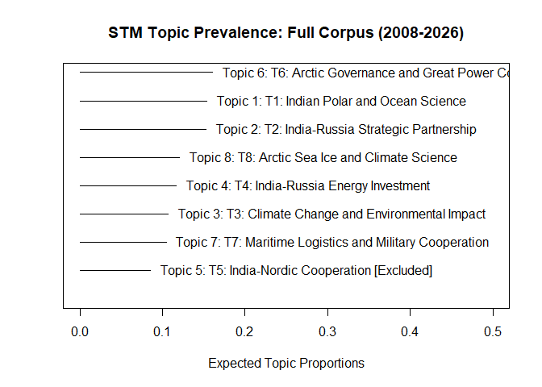<!-- -->

### 7.3 Framing Trajectory: Full Corpus

``` r
# Extract theta matrix (document-topic proportions)
theta_full <- as.data.frame(stm_full$theta)
colnames(theta_full) <- paste0("T", 1:8)
theta_full$year        <- corpus_full$year
theta_full$source_type <- corpus_full$source_type

# Raw framing scores
# Strategic: T2 (India-Russia Strategic), T4 (Energy Investment), T7 (Maritime Logistics)
# Climate-Science: T1 (Indian Polar Science), T3 (Climate Change), T8 (Arctic Sea Ice)
# Excluded: T5 (India-Nordic, mixed), T6 (Arctic Governance, mixed/noise)
theta_full <- theta_full %>%
  mutate(
    strategic_score = T2 + T4 + T7,
    climate_score   = T1 + T3 + T8
  )

# Yearly mean framing scores
yearly_full <- theta_full %>%
  group_by(year) %>%
  summarise(
    n_docs         = n(),
    strategic_mean = mean(strategic_score),
    climate_mean   = mean(climate_score),
    .groups        = "drop"
  )

# Reshape for plotting
yearly_full_long <- yearly_full %>%
  pivot_longer(cols = c(strategic_mean, climate_mean),
               names_to  = "framing",
               values_to = "proportion") %>%
  mutate(framing = recode(framing,
                          "strategic_mean" = "Strategic Framing",
                          "climate_mean"   = "Climate-Science Framing"))

p1 <- ggplot(yearly_full_long,
       aes(x = year, y = proportion, color = framing, group = framing)) +

  # Pre-observer contextual shading (2008-2012)
  annotate("rect", xmin = 2007.5, xmax = 2012.5, ymin = 0, ymax = 0.85,
           fill = "grey85", alpha = 0.5) +
  annotate("text", x = 2010, y = 0.80,
           label = "Pre-observer\ncontextual period",
           size = 2.8, color = "grey50", hjust = 0.5) +

  geom_line(linewidth = 1.0) +
  geom_point(size = 2.0) +
  geom_smooth(method = "loess", se = FALSE,
              linewidth = 0.5, linetype = "dashed", alpha = 0.7) +

  # Document count labels
  geom_text(data = yearly_full,
            aes(x = year, y = -0.04, label = paste0("n=", n_docs)),
            inherit.aes = FALSE,
            size = 2.3, color = "grey50", angle = 45) +

  scale_color_manual(values = c(
    "Strategic Framing"       = "#2166ac",
    "Climate-Science Framing" = "#1a9850")) +

  scale_x_continuous(breaks = 2008:2026) +
  scale_y_continuous(limits = c(-0.08, 0.85),
                     labels = percent_format(accuracy = 1)) +

  labs(
    title    = "Strategic vs Climate-Science Framing of the Arctic in Indian Discourse",
    subtitle = "Full corpus (2008-2026) | Raw mean topic proportion | STM K=8",
    x        = "Year",
    y        = "Mean Topic Proportion",
    color    = "Framing Type",
    caption  = paste0(
      "N = ", nrow(corpus_full), " documents | ",
      "Strategic: T2+T4+T7 | Climate-Science: T1+T3+T8 | ",
      "T5 and T6 excluded (mixed/noise) | ",
      "Dashed lines = loess smoother | ",
      "Scores do not sum to 1; remaining proportion reflects excluded topics")
  ) +

  theme_minimal() +
  theme(
    axis.text.x      = element_text(angle = 45, hjust = 1, size = 9),
    legend.position  = "bottom",
    plot.title       = element_text(face = "bold", size = 12),
    plot.subtitle    = element_text(size = 9, color = "grey40"),
    plot.caption     = element_text(size = 7, color = "grey50"),
    panel.grid.minor = element_blank()
  )

print(p1)
```

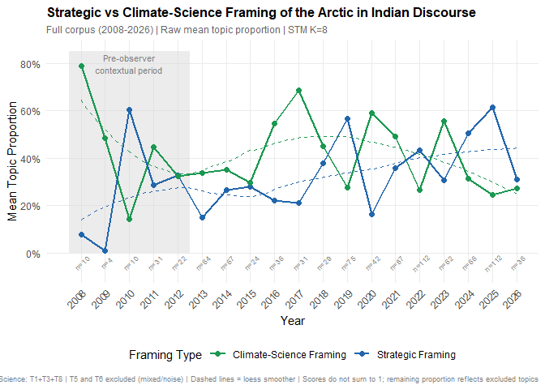<!-- -->

``` r
ggsave(here("figures", "plot1_full_corpus_trajectory.png"),
       plot = p1, width = 13, height = 7, dpi = 300)
```

------------------------------------------------------------------------

## 8. STM: Public Discourse (2013-2026)

### 8.1 Preprocess and SearchK

``` r
prep_pub <- preprocess_corpus(corpus_pub)
year_pub <- corpus_pub$year

cat("Public Discourse DFM dimensions:", dim(prep_pub$dfm), "\n")
```

    ## Public Discourse DFM dimensions: 790 5998

``` r
set.seed(123)
searchk_pub <- searchK(
  documents  = prep_pub$stm_input$documents,
  vocab      = prep_pub$stm_input$vocab,
  K          = c(6, 8, 10, 12, 15),
  prevalence = ~ year_pub,
  data       = prep_pub$stm_input$meta,
  init.type  = "Spectral",
  verbose    = FALSE
)

plot(searchk_pub)
```

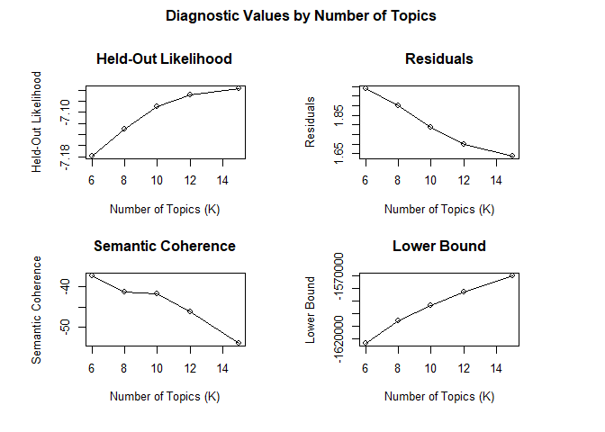<!-- -->

``` r
# SearchK results as readable table
data.frame(
  K        = unlist(searchk_pub$results$K),
  semcoh   = round(unlist(searchk_pub$results$semcoh), 3),
  heldout  = round(unlist(searchk_pub$results$heldout), 3),
  residual = round(unlist(searchk_pub$results$residual), 3)
)
```

    ##    K  semcoh heldout residual
    ## 1  6 -37.250  -7.178    1.989
    ## 2  8 -41.207  -7.129    1.902
    ## 3 10 -41.616  -7.089    1.788
    ## 4 12 -46.188  -7.068    1.699
    ## 5 15 -54.038  -7.057    1.638

### 8.2 Run STM Model

``` r
# K = 8 selected on the basis of the searchK diagnostics above
set.seed(123)
stm_pub <- stm(
  documents  = prep_pub$stm_input$documents,
  vocab      = prep_pub$stm_input$vocab,
  K          = 8,
  prevalence = ~ year_pub,
  max.em.its = 100,
  data       = prep_pub$stm_input$meta,
  init.type  = "Spectral"
)
```

    ## Beginning Spectral Initialization 
    ##   Calculating the gram matrix...
    ##   Finding anchor words...
    ##      ........
    ##   Recovering initialization...
    ##      ...........................................................
    ## Initialization complete.
    ## ................................................................................................................
    ## Completed E-Step (2 seconds). 
    ## Completed M-Step. 
    ## Completing Iteration 1 (approx. per word bound = -7.406) 
    ## ................................................................................................................
    ## Completed E-Step (2 seconds). 
    ## Completed M-Step. 
    ## Completing Iteration 2 (approx. per word bound = -7.098, relative change = 4.155e-02) 
    ## ................................................................................................................
    ## Completed E-Step (2 seconds). 
    ## Completed M-Step. 
    ## Completing Iteration 3 (approx. per word bound = -7.068, relative change = 4.221e-03) 
    ## ................................................................................................................
    ## Completed E-Step (1 seconds). 
    ## Completed M-Step. 
    ## Completing Iteration 4 (approx. per word bound = -7.056, relative change = 1.719e-03) 
    ## ................................................................................................................
    ## Completed E-Step (1 seconds). 
    ## Completed M-Step. 
    ## Completing Iteration 5 (approx. per word bound = -7.048, relative change = 1.053e-03) 
    ## Topic 1: research, scienc, polar, region, ocean 
    ##  Topic 2: climat, chang, global, temperatur, world 
    ##  Topic 3: russia, cooper, india, countri, summit 
    ##  Topic 4: oil, russia, gas, energi, russian 
    ##  Topic 5: compani, energi, denmark, peopl, technolog 
    ##  Topic 6: russia, rout, russian, ship, sea 
    ##  Topic 7: ice, sea, ocean, chang, warm 
    ##  Topic 8: greenland, china, us, region, militari 
    ## ................................................................................................................
    ## Completed E-Step (1 seconds). 
    ## Completed M-Step. 
    ## Completing Iteration 6 (approx. per word bound = -7.044, relative change = 6.993e-04) 
    ## ................................................................................................................
    ## Completed E-Step (1 seconds). 
    ## Completed M-Step. 
    ## Completing Iteration 7 (approx. per word bound = -7.040, relative change = 4.595e-04) 
    ## ................................................................................................................
    ## Completed E-Step (1 seconds). 
    ## Completed M-Step. 
    ## Completing Iteration 8 (approx. per word bound = -7.038, relative change = 3.361e-04) 
    ## ................................................................................................................
    ## Completed E-Step (1 seconds). 
    ## Completed M-Step. 
    ## Completing Iteration 9 (approx. per word bound = -7.036, relative change = 2.656e-04) 
    ## ................................................................................................................
    ## Completed E-Step (1 seconds). 
    ## Completed M-Step. 
    ## Completing Iteration 10 (approx. per word bound = -7.035, relative change = 2.047e-04) 
    ## Topic 1: research, scienc, region, polar, ocean 
    ##  Topic 2: climat, chang, global, temperatur, world 
    ##  Topic 3: russia, cooper, india, summit, countri 
    ##  Topic 4: oil, russia, gas, energi, russian 
    ##  Topic 5: compani, denmark, peopl, energi, technolog 
    ##  Topic 6: russia, rout, russian, sea, ship 
    ##  Topic 7: ice, sea, ocean, studi, chang 
    ##  Topic 8: greenland, china, us, canada, trump 
    ## ................................................................................................................
    ## Completed E-Step (1 seconds). 
    ## Completed M-Step. 
    ## Completing Iteration 11 (approx. per word bound = -7.033, relative change = 1.645e-04) 
    ## ................................................................................................................
    ## Completed E-Step (1 seconds). 
    ## Completed M-Step. 
    ## Completing Iteration 12 (approx. per word bound = -7.032, relative change = 1.403e-04) 
    ## ................................................................................................................
    ## Completed E-Step (1 seconds). 
    ## Completed M-Step. 
    ## Completing Iteration 13 (approx. per word bound = -7.032, relative change = 1.251e-04) 
    ## ................................................................................................................
    ## Completed E-Step (1 seconds). 
    ## Completed M-Step. 
    ## Completing Iteration 14 (approx. per word bound = -7.031, relative change = 1.155e-04) 
    ## ................................................................................................................
    ## Completed E-Step (1 seconds). 
    ## Completed M-Step. 
    ## Completing Iteration 15 (approx. per word bound = -7.030, relative change = 1.096e-04) 
    ## Topic 1: research, scienc, region, polar, ocean 
    ##  Topic 2: climat, chang, global, temperatur, report 
    ##  Topic 3: russia, cooper, india, summit, trade 
    ##  Topic 4: oil, russia, gas, energi, russian 
    ##  Topic 5: compani, peopl, denmark, energi, green 
    ##  Topic 6: russia, russian, rout, sea, ship 
    ##  Topic 7: ice, sea, ocean, studi, research 
    ##  Topic 8: china, greenland, us, canada, region 
    ## ................................................................................................................
    ## Completed E-Step (1 seconds). 
    ## Completed M-Step. 
    ## Completing Iteration 16 (approx. per word bound = -7.029, relative change = 1.032e-04) 
    ## ................................................................................................................
    ## Completed E-Step (1 seconds). 
    ## Completed M-Step. 
    ## Completing Iteration 17 (approx. per word bound = -7.029, relative change = 9.529e-05) 
    ## ................................................................................................................
    ## Completed E-Step (1 seconds). 
    ## Completed M-Step. 
    ## Completing Iteration 18 (approx. per word bound = -7.028, relative change = 8.939e-05) 
    ## ................................................................................................................
    ## Completed E-Step (1 seconds). 
    ## Completed M-Step. 
    ## Completing Iteration 19 (approx. per word bound = -7.027, relative change = 8.190e-05) 
    ## ................................................................................................................
    ## Completed E-Step (1 seconds). 
    ## Completed M-Step. 
    ## Completing Iteration 20 (approx. per word bound = -7.027, relative change = 7.457e-05) 
    ## Topic 1: research, scienc, region, polar, council 
    ##  Topic 2: climat, chang, global, temperatur, report 
    ##  Topic 3: russia, cooper, india, summit, trade 
    ##  Topic 4: oil, russia, gas, energi, russian 
    ##  Topic 5: compani, peopl, denmark, govern, green 
    ##  Topic 6: russia, russian, rout, sea, ship 
    ##  Topic 7: ice, sea, ocean, studi, research 
    ##  Topic 8: china, us, greenland, canada, region 
    ## ................................................................................................................
    ## Completed E-Step (1 seconds). 
    ## Completed M-Step. 
    ## Completing Iteration 21 (approx. per word bound = -7.026, relative change = 6.814e-05) 
    ## ................................................................................................................
    ## Completed E-Step (1 seconds). 
    ## Completed M-Step. 
    ## Completing Iteration 22 (approx. per word bound = -7.026, relative change = 6.424e-05) 
    ## ................................................................................................................
    ## Completed E-Step (1 seconds). 
    ## Completed M-Step. 
    ## Completing Iteration 23 (approx. per word bound = -7.026, relative change = 6.064e-05) 
    ## ................................................................................................................
    ## Completed E-Step (1 seconds). 
    ## Completed M-Step. 
    ## Completing Iteration 24 (approx. per word bound = -7.025, relative change = 5.613e-05) 
    ## ................................................................................................................
    ## Completed E-Step (1 seconds). 
    ## Completed M-Step. 
    ## Completing Iteration 25 (approx. per word bound = -7.025, relative change = 5.142e-05) 
    ## Topic 1: research, scienc, region, polar, council 
    ##  Topic 2: climat, chang, temperatur, global, report 
    ##  Topic 3: cooper, russia, india, summit, trade 
    ##  Topic 4: oil, russia, gas, energi, russian 
    ##  Topic 5: compani, peopl, denmark, govern, climat 
    ##  Topic 6: russia, russian, rout, sea, ship 
    ##  Topic 7: ice, sea, ocean, studi, research 
    ##  Topic 8: china, us, greenland, canada, russia 
    ## ................................................................................................................
    ## Completed E-Step (1 seconds). 
    ## Completed M-Step. 
    ## Completing Iteration 26 (approx. per word bound = -7.024, relative change = 4.900e-05) 
    ## ................................................................................................................
    ## Completed E-Step (1 seconds). 
    ## Completed M-Step. 
    ## Completing Iteration 27 (approx. per word bound = -7.024, relative change = 4.709e-05) 
    ## ................................................................................................................
    ## Completed E-Step (1 seconds). 
    ## Completed M-Step. 
    ## Completing Iteration 28 (approx. per word bound = -7.024, relative change = 4.414e-05) 
    ## ................................................................................................................
    ## Completed E-Step (1 seconds). 
    ## Completed M-Step. 
    ## Completing Iteration 29 (approx. per word bound = -7.024, relative change = 4.063e-05) 
    ## ................................................................................................................
    ## Completed E-Step (1 seconds). 
    ## Completed M-Step. 
    ## Completing Iteration 30 (approx. per word bound = -7.023, relative change = 3.841e-05) 
    ## Topic 1: research, scienc, region, polar, ocean 
    ##  Topic 2: climat, chang, temperatur, global, report 
    ##  Topic 3: cooper, russia, summit, india, trade 
    ##  Topic 4: oil, russia, gas, energi, russian 
    ##  Topic 5: peopl, compani, denmark, govern, develop 
    ##  Topic 6: russia, russian, rout, sea, ship 
    ##  Topic 7: ice, sea, ocean, studi, research 
    ##  Topic 8: china, us, russia, greenland, canada 
    ## ................................................................................................................
    ## Completed E-Step (1 seconds). 
    ## Completed M-Step. 
    ## Completing Iteration 31 (approx. per word bound = -7.023, relative change = 3.897e-05) 
    ## ................................................................................................................
    ## Completed E-Step (1 seconds). 
    ## Completed M-Step. 
    ## Completing Iteration 32 (approx. per word bound = -7.023, relative change = 3.922e-05) 
    ## ................................................................................................................
    ## Completed E-Step (1 seconds). 
    ## Completed M-Step. 
    ## Completing Iteration 33 (approx. per word bound = -7.022, relative change = 3.633e-05) 
    ## ................................................................................................................
    ## Completed E-Step (1 seconds). 
    ## Completed M-Step. 
    ## Completing Iteration 34 (approx. per word bound = -7.022, relative change = 3.370e-05) 
    ## ................................................................................................................
    ## Completed E-Step (1 seconds). 
    ## Completed M-Step. 
    ## Completing Iteration 35 (approx. per word bound = -7.022, relative change = 2.927e-05) 
    ## Topic 1: research, scienc, region, polar, ocean 
    ##  Topic 2: climat, chang, temperatur, global, report 
    ##  Topic 3: cooper, russia, summit, india, trade 
    ##  Topic 4: oil, russia, gas, energi, russian 
    ##  Topic 5: peopl, compani, denmark, govern, develop 
    ##  Topic 6: russia, russian, rout, sea, ship 
    ##  Topic 7: ice, sea, ocean, studi, research 
    ##  Topic 8: china, us, russia, greenland, global 
    ## ................................................................................................................
    ## Completed E-Step (1 seconds). 
    ## Completed M-Step. 
    ## Completing Iteration 36 (approx. per word bound = -7.022, relative change = 2.618e-05) 
    ## ................................................................................................................
    ## Completed E-Step (1 seconds). 
    ## Completed M-Step. 
    ## Completing Iteration 37 (approx. per word bound = -7.022, relative change = 2.694e-05) 
    ## ................................................................................................................
    ## Completed E-Step (1 seconds). 
    ## Completed M-Step. 
    ## Completing Iteration 38 (approx. per word bound = -7.021, relative change = 2.797e-05) 
    ## ................................................................................................................
    ## Completed E-Step (1 seconds). 
    ## Completed M-Step. 
    ## Completing Iteration 39 (approx. per word bound = -7.021, relative change = 2.784e-05) 
    ## ................................................................................................................
    ## Completed E-Step (1 seconds). 
    ## Completed M-Step. 
    ## Completing Iteration 40 (approx. per word bound = -7.021, relative change = 2.569e-05) 
    ## Topic 1: research, scienc, polar, region, ocean 
    ##  Topic 2: climat, chang, temperatur, global, report 
    ##  Topic 3: cooper, russia, summit, india, partnership 
    ##  Topic 4: oil, russia, gas, energi, russian 
    ##  Topic 5: peopl, compani, denmark, govern, develop 
    ##  Topic 6: russia, russian, rout, sea, ship 
    ##  Topic 7: ice, sea, ocean, studi, research 
    ##  Topic 8: china, russia, us, greenland, global 
    ## ................................................................................................................
    ## Completed E-Step (1 seconds). 
    ## Completed M-Step. 
    ## Completing Iteration 41 (approx. per word bound = -7.021, relative change = 2.317e-05) 
    ## ................................................................................................................
    ## Completed E-Step (1 seconds). 
    ## Completed M-Step. 
    ## Completing Iteration 42 (approx. per word bound = -7.021, relative change = 2.136e-05) 
    ## ................................................................................................................
    ## Completed E-Step (1 seconds). 
    ## Completed M-Step. 
    ## Completing Iteration 43 (approx. per word bound = -7.021, relative change = 1.910e-05) 
    ## ................................................................................................................
    ## Completed E-Step (1 seconds). 
    ## Completed M-Step. 
    ## Completing Iteration 44 (approx. per word bound = -7.020, relative change = 1.804e-05) 
    ## ................................................................................................................
    ## Completed E-Step (1 seconds). 
    ## Completed M-Step. 
    ## Completing Iteration 45 (approx. per word bound = -7.020, relative change = 1.894e-05) 
    ## Topic 1: research, scienc, polar, region, ocean 
    ##  Topic 2: climat, chang, temperatur, global, report 
    ##  Topic 3: cooper, russia, summit, india, partnership 
    ##  Topic 4: oil, russia, gas, energi, russian 
    ##  Topic 5: peopl, compani, denmark, govern, develop 
    ##  Topic 6: russia, russian, rout, sea, ship 
    ##  Topic 7: ice, sea, ocean, studi, research 
    ##  Topic 8: china, russia, us, global, greenland 
    ## ................................................................................................................
    ## Completed E-Step (1 seconds). 
    ## Completed M-Step. 
    ## Completing Iteration 46 (approx. per word bound = -7.020, relative change = 2.149e-05) 
    ## ................................................................................................................
    ## Completed E-Step (1 seconds). 
    ## Completed M-Step. 
    ## Completing Iteration 47 (approx. per word bound = -7.020, relative change = 2.209e-05) 
    ## ................................................................................................................
    ## Completed E-Step (1 seconds). 
    ## Completed M-Step. 
    ## Completing Iteration 48 (approx. per word bound = -7.020, relative change = 1.981e-05) 
    ## ................................................................................................................
    ## Completed E-Step (1 seconds). 
    ## Completed M-Step. 
    ## Completing Iteration 49 (approx. per word bound = -7.020, relative change = 1.721e-05) 
    ## ................................................................................................................
    ## Completed E-Step (1 seconds). 
    ## Completed M-Step. 
    ## Completing Iteration 50 (approx. per word bound = -7.020, relative change = 1.332e-05) 
    ## Topic 1: research, scienc, polar, region, ocean 
    ##  Topic 2: climat, chang, temperatur, global, report 
    ##  Topic 3: cooper, russia, summit, partnership, india 
    ##  Topic 4: oil, russia, gas, energi, russian 
    ##  Topic 5: peopl, compani, denmark, govern, develop 
    ##  Topic 6: russia, russian, rout, sea, ship 
    ##  Topic 7: ice, sea, ocean, studi, research 
    ##  Topic 8: china, russia, us, global, greenland 
    ## ................................................................................................................
    ## Completed E-Step (1 seconds). 
    ## Completed M-Step. 
    ## Completing Iteration 51 (approx. per word bound = -7.020, relative change = 1.180e-05) 
    ## ................................................................................................................
    ## Completed E-Step (1 seconds). 
    ## Completed M-Step. 
    ## Completing Iteration 52 (approx. per word bound = -7.020, relative change = 1.125e-05) 
    ## ................................................................................................................
    ## Completed E-Step (1 seconds). 
    ## Completed M-Step. 
    ## Model Converged

``` r
# Examine top words per topic to inform framing assignment
labelTopics(stm_pub, n = 15)
```

    ## Topic 1 Top Words:
    ##       Highest Prob: research, scienc, polar, region, ocean, scientif, council, india, climat, norway, observ, institut, develop, earth, nation 
    ##       FREX: moe, himadri, scienc, scientif, expedit, antarct, station, research, polar, mukherje, ncpor, maitri, svalbard, institut, meloth 
    ##       Lift: maitri, nayak, 27-28, 45th, 46th, 8-9, academician, aegi, afop, alesund, allot, asm, astrophys, aurora, ayurved 
    ##       Score: ncpor, moe, himadri, polar, scienc, rijiju, scientist, station, scientif, antarctica, monsoon, antarct, mukherje, research, meloth 
    ## Topic 2 Top Words:
    ##       Highest Prob: climat, chang, temperatur, global, report, warm, world, region, increas, impact, weather, time, extrem, record, rise 
    ##       FREX: heatwav, flood, wmo, rainfal, bird, displac, drought, degre, seed, rain, retreat, temperatur, celsius, plain, extrem 
    ##       Lift: 1850-1900, 1991-2020, 38degc, 50-year, ammonia, amplitud, andhra, ar5, balachandran, buse, cancer, catchment, cerveni, chhattisgarh, chilika 
    ##       Score: temperatur, rainfal, heatwav, bird, wmo, climat, plain, flood, displac, ipcc, seed, migratori, g20, wildfir, glacier 
    ## Topic 3 Top Words:
    ##       Highest Prob: cooper, russia, summit, partnership, trade, bilater, india, energi, countri, putin, russian, leader, meet, pm, discuss 
    ##       FREX: terror, pm, summit, bilater, leader, bric, welcom, ukrain, modi, side, jaishankar, dialogu, putin, india-russia, narendra 
    ##       Lift: cherish, india-indonesia, keir, lui, olymp, over-cauti, pak, paralymp, rapport, ric, russia-india-china, sputnik-v, su-57, urea, ursula 
    ##       Score: putin, bilater, india-russia, bric, pm, terror, jaishankar, ukrain, cooper, vladivostok, leader, trade, defenc, meloni, mutual 
    ## Topic 4 Top Words:
    ##       Highest Prob: oil, russia, gas, energi, russian, lng, project, invest, compani, import, billion, export, crude, us, natur 
    ##       FREX: ovl, rosneft, ongc, videsh, lng, crude, novatek, petroleum, vankor, vostok, oil, ioc, gas, ltd, price 
    ##       Lift: roseneft, essar, ioc, nayara, petroresourc, taas-yuryakh, #38, 2011-12, 4-day, adequaci, annum, apprais, bp, bpcl, bprl 
    ##       Score: ovl, lng, rosneft, ongc, oil, ioc, coke, ltd, sanction, novatek, petroleum, crude, vankor, videsh, mt 
    ## Topic 5 Top Words:
    ##       Highest Prob: peopl, compani, denmark, govern, develop, climat, sweden, world, nordic, chang, technolog, global, environ, work, norway 
    ##       FREX: greenpeac, india-nord, drill, frederiksen, oneweb, swedish, fisheri, activist, sweden, nordic, languag, copenhagen, danish, mett, stock 
    ##       Lift: broadband, nb8, @statsmin, adani, airtel, amnesti, athabaskan, autom, banner, ben, bernadett, boem, chase, chirag, cii 
    ##       Score: greenpeac, india-nord, danish, frederiksen, oneweb, nordic, denmark, compani, chase, satcom, mett, copenhagen, majesti, shri, sunris 
    ## Topic 6 Top Words:
    ##       Highest Prob: russia, russian, rout, sea, ship, agreement, region, maritim, northern, develop, cooper, port, logist, oper, militari 
    ##       FREX: nsr, relo, shipbuild, icebreak, logist, rout, port, sonow, rosatom, maritim, navi, instc, exercis, corridor, pact 
    ##       Lift: 10-12, 5,600km, abe, alang, arl, atomexpo, babushkin, beca, catalyst, chekunkov, comcasa, copper, diamonds.th, encrypt, escort 
    ##       Score: relo, nsr, corridor, russian, icebreak, instc, vladivostok, shipbuild, maritim, ior, pact, sonow, rout, logist, iran 
    ## Topic 7 Top Words:
    ##       Highest Prob: ice, sea, ocean, studi, research, chang, melt, warm, climat, scientist, summer, region, water, data, surfac 
    ##       FREX: icebridg, ice-fre, ice, nasa, extent, permafrost, whale, mercuri, surfac, thaw, summer, cloud, snow, thick, flight 
    ##       Lift: 1979-2018, 1981-2010, 8,500-km, absorpt, adjunct, airborn, alga, anymor, atmosphere-ice-ocean, awi, backman, bowhead, brine, c-130, chris 
    ##       Score: ice, icebridg, surfac, scientist, summer, nasa, mercuri, melt, whale, permafrost, nsidc, multiyear, landsat, temperatur, bowhead 
    ## Topic 8 Top Words:
    ##       Highest Prob: china, russia, us, global, greenland, region, interest, secur, state, canada, strateg, trump, geopolit, india, militari 
    ##       FREX: nato, trump, greenland, chines, narrat, polit, china, geopolit, alli, beij, tension, donald, canada, pressur, defens 
    ##       Lift: 2,910km, 9,240km, bal, battleground, cautious, chessboard, clash, communist, davo, de-escal, depsang, deterr, drawn, dual-us, eged 
    ##       Score: greenland, trump, nato, chines, militari, geopolit, troop, danish, denmark, indo-ganget, tariff, disengag, narrat, beij, alli

``` r
# Topic labels based on theoretical interpretation of top words
# Strategic framing: T3, T4, T6, T8
# Climate-Science framing: T1, T2, T7
# Excluded (mixed/noise): T5 (India-Nordic merged with environmental activism)
labels_pub <- c(
  "T1: Indian Polar and Ocean Science",                        # Climate-Science
  "T2: Climate Change and Environmental Impact",               # Climate-Science
  "T3: India-Russia Strategic Partnership",                    # Strategic
  "T4: India-Russia Energy Investment",                        # Strategic
  "T5: India-Nordic and Environmental Activism [Excluded]",    # Excluded
  "T6: Maritime Logistics and Military Cooperation",           # Strategic
  "T7: Arctic Sea Ice and Climate Science",                    # Climate-Science
  "T8: Arctic Geopolitics and Great Power Competition"         # Strategic
)

# Visual summary of topic prevalence
plot(stm_pub, type = "summary",
     custom.labels = labels_pub,
     xlim = c(0, 0.5),
     main = "STM Topic Prevalence: Public Discourse (2013-2026)")
```

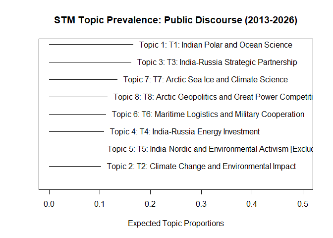<!-- -->

### 8.3 Framing Trajectory: Public Discourse

``` r
# Extract theta matrix (document-topic proportions)
theta_pub <- as.data.frame(stm_pub$theta)
colnames(theta_pub) <- paste0("T", 1:8)
theta_pub$year <- corpus_pub$year

# Raw framing scores
# Strategic: T3 (India-Russia Strategic), T4 (Energy Investment),
#            T6 (Maritime Logistics), T8 (Arctic Geopolitics)
# Climate-Science: T1 (Indian Polar Science), T2 (Climate Change), T7 (Arctic Sea Ice)
# Excluded: T5 (India-Nordic/Environmental Activism, mixed/noise)
theta_pub <- theta_pub %>%
  mutate(
    strategic_score = T3 + T4 + T6 + T8,
    climate_score   = T1 + T2 + T7
  )

# Yearly mean framing scores
yearly_pub <- theta_pub %>%
  group_by(year) %>%
  summarise(
    n_docs         = n(),
    strategic_mean = mean(strategic_score),
    climate_mean   = mean(climate_score),
    .groups        = "drop"
  )

# Reshape for plotting
yearly_pub_long <- yearly_pub %>%
  pivot_longer(cols = c(strategic_mean, climate_mean),
               names_to  = "framing",
               values_to = "proportion") %>%
  mutate(framing = recode(framing,
                          "strategic_mean" = "Strategic Framing",
                          "climate_mean"   = "Climate-Science Framing"))

p2 <- ggplot(yearly_pub_long,
       aes(x = year, y = proportion, color = framing, group = framing)) +

  geom_line(linewidth = 1.0) +
  geom_point(size = 2.0) +
  geom_smooth(method = "loess", se = FALSE,
              linewidth = 0.5, linetype = "dashed", alpha = 0.7) +

  # Document count labels
  geom_text(data = yearly_pub,
            aes(x = year, y = -0.04, label = paste0("n=", n_docs)),
            inherit.aes = FALSE,
            size = 2.3, color = "grey50", angle = 45) +

  scale_color_manual(values = c(
    "Strategic Framing"       = "#2166ac",
    "Climate-Science Framing" = "#1a9850")) +

  scale_x_continuous(breaks = 2013:2026) +
  scale_y_continuous(limits = c(-0.08, 0.85),
                     labels = percent_format(accuracy = 1)) +

  labs(
    title    = "Strategic vs Climate-Science Framing: Public Discourse",
    subtitle = "Public Discourse only (2013-2026) | Raw mean topic proportion | STM K=8",
    x        = "Year",
    y        = "Mean Topic Proportion",
    color    = "Framing Type",
    caption  = paste0(
      "N = ", nrow(corpus_pub), " documents | ",
      "Strategic: T3+T4+T6+T8 | Climate-Science: T1+T2+T7 | ",
      "T5 excluded (mixed/noise) | ",
      "Dashed lines = loess smoother | ",
      "Scores do not sum to 1; remaining proportion reflects excluded topic")
  ) +

  theme_minimal() +
  theme(
    axis.text.x      = element_text(angle = 45, hjust = 1, size = 9),
    legend.position  = "bottom",
    plot.title       = element_text(face = "bold", size = 12),
    plot.subtitle    = element_text(size = 9, color = "grey40"),
    plot.caption     = element_text(size = 7, color = "grey50"),
    panel.grid.minor = element_blank()
  )

print(p2)
```

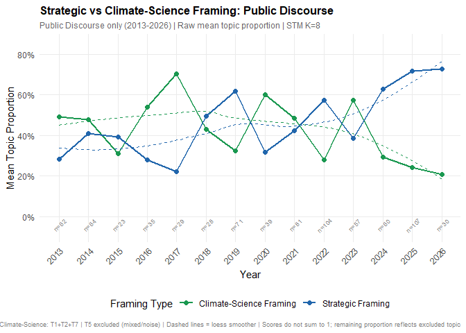<!-- -->

``` r
ggsave(here("figures", "plot2_public_discourse_trajectory.png"),
       plot = p2, width = 13, height = 7, dpi = 300)
```

### 8.4 EstimateEffect: Public Discourse

``` r
# Estimate effect of year on topic prevalence
# Tests whether topic proportions change significantly over time
prep_effect_pub <- estimateEffect(
  formula  = 1:8 ~ year_pub,
  stmobj   = stm_pub,
  metadata = data.frame(year_pub = year_pub)
)

# Strategic topics: expected to increase over time
plot(prep_effect_pub,
     covariate     = "year_pub",
     topics        = c(3, 4, 6, 8),
     method        = "continuous",
     xlab          = "Year",
     ylab          = "Expected Topic Proportion",
     main          = "Strategic Topics: Prevalence Over Time (Public Discourse)",
     labeltype     = "custom",
     custom.labels = c(
       "T3: India-Russia Strategic",
       "T4: India-Russia Energy",
       "T6: Maritime Logistics",
       "T8: Arctic Geopolitics"
     ))
```

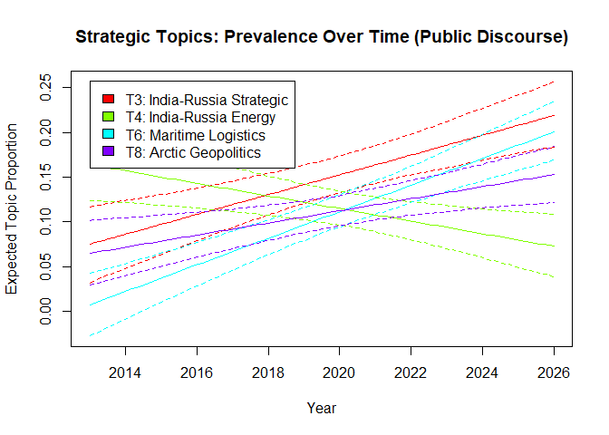<!-- -->

``` r
# Climate-science topics: expected to decrease or remain stable
plot(prep_effect_pub,
     covariate     = "year_pub",
     topics        = c(1, 2, 7),
     method        = "continuous",
     xlab          = "Year",
     ylab          = "Expected Topic Proportion",
     main          = "Climate-Science Topics: Prevalence Over Time (Public Discourse)",
     labeltype     = "custom",
     custom.labels = c(
       "T1: Indian Polar Science",
       "T2: Climate Change",
       "T7: Arctic Sea Ice Science"
     ))
```

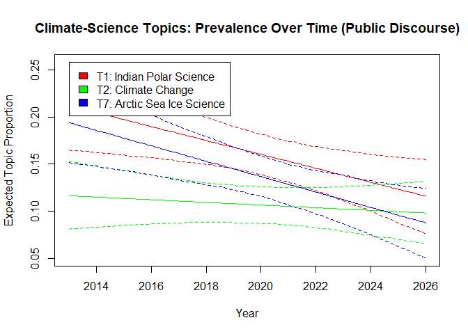<!-- -->

------------------------------------------------------------------------

## 9. STM: Government Documents (2013-2026)

### 9.1 Preprocess and SearchK

``` r
prep_gov <- preprocess_corpus(corpus_gov)
year_gov <- corpus_gov$year

cat("Government corpus DFM dimensions:", dim(prep_gov$dfm), "\n")
```

    ## Government corpus DFM dimensions: 53 1449

``` r
cat("Note: Small corpus (n =", nrow(corpus_gov),
    "), lower K range tested\n")
```

    ## Note: Small corpus (n = 53 ), lower K range tested

``` r
set.seed(123)
searchk_gov <- searchK(
  documents  = prep_gov$stm_input$documents,
  vocab      = prep_gov$stm_input$vocab,
  K          = c(3, 4, 5, 6),
  prevalence = ~ year_gov,
  data       = prep_gov$stm_input$meta,
  init.type  = "Spectral",
  verbose    = FALSE
)

plot(searchk_gov)
```

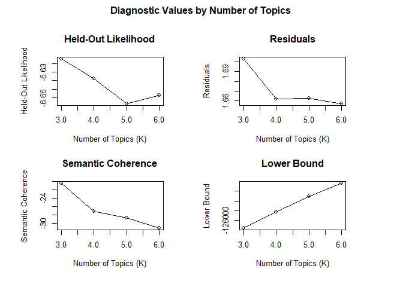<!-- -->

``` r
data.frame(
  K        = unlist(searchk_gov$results$K),
  semcoh   = round(unlist(searchk_gov$results$semcoh), 3),
  heldout  = round(unlist(searchk_gov$results$heldout), 3),
  residual = round(unlist(searchk_gov$results$residual), 3)
)
```

    ##   K  semcoh heldout residual
    ## 1 3 -20.417  -6.615    1.703
    ## 2 4 -27.171  -6.638    1.662
    ## 3 5 -28.723  -6.667    1.663
    ## 4 6 -31.186  -6.657    1.657

### 9.2 Run STM Model

``` r
# K = 3 selected: semantic coherence peaks clearly at K = 3
set.seed(123)
stm_gov <- stm(
  documents  = prep_gov$stm_input$documents,
  vocab      = prep_gov$stm_input$vocab,
  K          = 3,
  prevalence = ~ year_gov,
  max.em.its = 100,
  data       = prep_gov$stm_input$meta,
  init.type  = "Spectral"
)
```

    ## Beginning Spectral Initialization 
    ##   Calculating the gram matrix...
    ##   Finding anchor words...
    ##      ...
    ##   Recovering initialization...
    ##      ..............
    ## Initialization complete.
    ## .....................................................
    ## Completed E-Step (0 seconds). 
    ## Completed M-Step. 
    ## Completing Iteration 1 (approx. per word bound = -6.667) 
    ## .....................................................
    ## Completed E-Step (0 seconds). 
    ## Completed M-Step. 
    ## Completing Iteration 2 (approx. per word bound = -6.425, relative change = 3.625e-02) 
    ## .....................................................
    ## Completed E-Step (0 seconds). 
    ## Completed M-Step. 
    ## Completing Iteration 3 (approx. per word bound = -6.395, relative change = 4.598e-03) 
    ## .....................................................
    ## Completed E-Step (0 seconds). 
    ## Completed M-Step. 
    ## Completing Iteration 4 (approx. per word bound = -6.388, relative change = 1.191e-03) 
    ## .....................................................
    ## Completed E-Step (0 seconds). 
    ## Completed M-Step. 
    ## Completing Iteration 5 (approx. per word bound = -6.384, relative change = 6.056e-04) 
    ## Topic 1: research, ocean, scienc, polar, committe 
    ##  Topic 2: cooper, leader, finland, region, global 
    ##  Topic 3: shri, cooper, discuss, russian, energi 
    ## .....................................................
    ## Completed E-Step (0 seconds). 
    ## Completed M-Step. 
    ## Completing Iteration 6 (approx. per word bound = -6.381, relative change = 4.042e-04) 
    ## .....................................................
    ## Completed E-Step (0 seconds). 
    ## Completed M-Step. 
    ## Completing Iteration 7 (approx. per word bound = -6.380, relative change = 2.941e-04) 
    ## .....................................................
    ## Completed E-Step (0 seconds). 
    ## Completed M-Step. 
    ## Completing Iteration 8 (approx. per word bound = -6.378, relative change = 1.864e-04) 
    ## .....................................................
    ## Completed E-Step (0 seconds). 
    ## Completed M-Step. 
    ## Completing Iteration 9 (approx. per word bound = -6.378, relative change = 1.072e-04) 
    ## .....................................................
    ## Completed E-Step (0 seconds). 
    ## Completed M-Step. 
    ## Completing Iteration 10 (approx. per word bound = -6.377, relative change = 6.749e-05) 
    ## Topic 1: research, ocean, scienc, polar, committe 
    ##  Topic 2: cooper, leader, region, finland, countri 
    ##  Topic 3: shri, cooper, russian, discuss, maritim 
    ## .....................................................
    ## Completed E-Step (0 seconds). 
    ## Completed M-Step. 
    ## Completing Iteration 11 (approx. per word bound = -6.377, relative change = 4.994e-05) 
    ## .....................................................
    ## Completed E-Step (0 seconds). 
    ## Completed M-Step. 
    ## Completing Iteration 12 (approx. per word bound = -6.377, relative change = 3.991e-05) 
    ## .....................................................
    ## Completed E-Step (0 seconds). 
    ## Completed M-Step. 
    ## Completing Iteration 13 (approx. per word bound = -6.376, relative change = 3.010e-05) 
    ## .....................................................
    ## Completed E-Step (0 seconds). 
    ## Completed M-Step. 
    ## Completing Iteration 14 (approx. per word bound = -6.376, relative change = 2.203e-05) 
    ## .....................................................
    ## Completed E-Step (0 seconds). 
    ## Completed M-Step. 
    ## Completing Iteration 15 (approx. per word bound = -6.376, relative change = 1.691e-05) 
    ## Topic 1: research, ocean, scienc, polar, committe 
    ##  Topic 2: cooper, leader, region, finland, countri 
    ##  Topic 3: shri, cooper, russian, discuss, maritim 
    ## .....................................................
    ## Completed E-Step (0 seconds). 
    ## Completed M-Step. 
    ## Completing Iteration 16 (approx. per word bound = -6.376, relative change = 1.296e-05) 
    ## .....................................................
    ## Completed E-Step (0 seconds). 
    ## Completed M-Step. 
    ## Completing Iteration 17 (approx. per word bound = -6.376, relative change = 1.022e-05) 
    ## .....................................................
    ## Completed E-Step (0 seconds). 
    ## Completed M-Step. 
    ## Model Converged

``` r
# Examine top words per topic to inform framing assignment
labelTopics(stm_gov, n = 15)
```

    ## Topic 1 Top Words:
    ##       Highest Prob: research, ocean, scienc, polar, committe, ministri, technolog, nation, scientif, earth, observ, region, develop, institut, system 
    ##       FREX: committe, india’, moe, antarctica, crore, alloc, oceanograph, ncpor, m, radar, cryospher, outlay, sagar, advisori, pune 
    ##       Lift: accur, acquisit, alert, allot, analysi, augment, avoid, background, basi, beach, biolog, borehol, bottom, breaker, cabinet 
    ##       Score: committe, memorandum, moe, india’, forecast, outlay, alloc, crore, scheme, ncpor, weather, cryospher, advisori, winter, pune 
    ## Topic 2 Top Words:
    ##       Highest Prob: cooper, region, leader, finland, countri, global, partnership, technolog, india, sustain, collabor, bilater, norway, develop, includ 
    ##       FREX: finland, finnish, india-eu, india-nord, innov, digit, mutual, multilater, sweden, educ, affair, un, republ, agre, law 
    ##       Lift: flight, gamut, geotherm, helsinki, kovind, sanna, shown, stockholm, tech, 6g, conclus, democraci, finland, finnish, india-eu 
    ##       Score: finland, shown, leader, finnish, side, india-eu, summit, green, stubb, agre, bilater, dialogu, trade, india-finland, mutual 
    ## Topic 3 Top Words:
    ##       Highest Prob: shri, cooper, russian, discuss, maritim, energi, russia, partnership, countri, trade, secretari, denmark, thank, leader, work 
    ##       FREX: russian, russia, mention, ma'am, sonow, maritim, bric, question, pradhan, think, know, thank, port, steel, gas 
    ##       Lift: coal, coke, dharmendra, explain, fact, got, hindu, legaci, ratifi, sechin, tell, volum, wion, ancient, briefli 
    ##       Score: pilot, russian, ma'am, leader, side, pradhan, russia, denmark, bric, steel, element, trade, question, mention, spokesperson

``` r
# Topic labels based on theoretical interpretation of top words
# Strategic framing: T3
# Climate-Science framing: T1
# Excluded (mixed): T2 (India-Nordic diplomatic cooperation; straddles
#   sustainability and diplomatic registers, consistent with exclusion
#   of the India-Nordic topic across all three STM runs)
labels_gov <- c(
  "T1: Indian Polar and Ocean Science [Climate-Science]",
  "T2: India-Nordic Diplomatic Cooperation [Excluded: Mixed]",
  "T3: India-Russia Strategic and Energy Engagement [Strategic]"
)

# Visual summary of topic prevalence
plot(stm_gov, type = "summary",
     custom.labels = labels_gov,
     xlim = c(0, 0.6),
     main = "STM Topic Prevalence: Government Documents (2013-2026)")
```

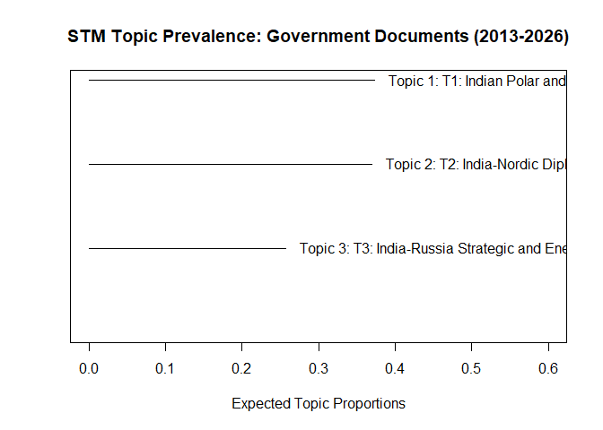<!-- -->

### 9.3 Framing Trajectory: Government Documents

``` r
# Extract theta matrix (document-topic proportions)
theta_gov <- as.data.frame(stm_gov$theta)
colnames(theta_gov) <- paste0("T", 1:3)
theta_gov$year <- corpus_gov$year

# Raw framing scores
# Strategic: T3 (India-Russia Strategic and Energy Engagement)
# Climate-Science: T1 (Indian Polar and Ocean Science)
# Excluded: T2 (India-Nordic, mixed)
theta_gov <- theta_gov %>%
  mutate(
    strategic_score = T3,
    climate_score   = T1
  )

# Yearly mean framing scores
yearly_gov <- theta_gov %>%
  group_by(year) %>%
  summarise(
    n_docs         = n(),
    strategic_mean = mean(strategic_score),
    climate_mean   = mean(climate_score),
    .groups        = "drop"
  )

# Yearly counts, important for interpreting reliability
cat("Government documents per year:\n")
```

    ## Government documents per year:

``` r
print(yearly_gov %>% select(year, n_docs), n = Inf)
```

    ## # A tibble: 14 × 2
    ##     year n_docs
    ##    <int>  <int>
    ##  1  2013      2
    ##  2  2014      3
    ##  3  2015      1
    ##  4  2016      1
    ##  5  2017      2
    ##  6  2018      1
    ##  7  2019      4
    ##  8  2020      3
    ##  9  2021      6
    ## 10  2022      8
    ## 11  2023      5
    ## 12  2024      6
    ## 13  2025      5
    ## 14  2026      6

``` r
# Reshape for plotting
yearly_gov_long <- yearly_gov %>%
  pivot_longer(cols = c(strategic_mean, climate_mean),
               names_to  = "framing",
               values_to = "proportion") %>%
  mutate(framing = recode(framing,
                          "strategic_mean" = "Strategic Framing",
                          "climate_mean"   = "Climate-Science Framing"))

p3 <- ggplot(yearly_gov_long,
       aes(x = year, y = proportion, color = framing, group = framing)) +

  geom_line(linewidth = 1.0) +
  geom_point(size = 2.0) +
  geom_smooth(method = "loess", se = FALSE,
              linewidth = 0.5, linetype = "dashed", alpha = 0.7) +

  # Document count labels
  geom_text(data = yearly_gov,
            aes(x = year, y = -0.04, label = paste0("n=", n_docs)),
            inherit.aes = FALSE,
            size = 2.3, color = "grey50", angle = 45) +

  scale_color_manual(values = c(
    "Strategic Framing"       = "#2166ac",
    "Climate-Science Framing" = "#1a9850")) +

  scale_x_continuous(breaks = 2013:2026) +
  scale_y_continuous(limits = c(-0.08, 1.05),
                     labels = percent_format(accuracy = 1)) +

  labs(
    title    = "Strategic vs Climate-Science Framing: Government Documents",
    subtitle = "Government only (2013-2026) | Raw mean topic proportion | STM K=3",
    x        = "Year",
    y        = "Mean Topic Proportion",
    color    = "Framing Type",
    caption  = paste0(
      "N = ", nrow(corpus_gov), " documents | ",
      "Strategic: T3 | Climate-Science: T1 | ",
      "T2 excluded (mixed) | ",
      "Dashed lines = loess smoother | ",
      "Caution: small corpus, n per year shown above | ",
      "Temporal estimates unreliable in years with n < 3 | ",
      "This analysis motivates the qualitative coding approach adopted subsequently")
  ) +

  theme_minimal() +
  theme(
    axis.text.x      = element_text(angle = 45, hjust = 1, size = 9),
    legend.position  = "bottom",
    plot.title       = element_text(face = "bold", size = 12),
    plot.subtitle    = element_text(size = 9, color = "grey40"),
    plot.caption     = element_text(size = 7, color = "grey50"),
    panel.grid.minor = element_blank()
  )

print(p3)
```

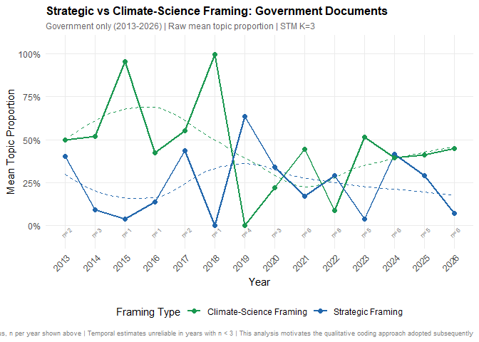<!-- -->

``` r
ggsave(here("figures", "plot3_government_trajectory.png"),
       plot = p3, width = 13, height = 7, dpi = 300)
```

### 9.4 EstimateEffect: Government Documents

``` r
# Wide confidence intervals are expected given the small corpus.
# Results demonstrate the unreliability of STM temporal estimation
# on sparse government data, motivating the qualitative coding approach.
prep_effect_gov <- estimateEffect(
  formula  = 1:3 ~ year_gov,
  stmobj   = stm_gov,
  metadata = data.frame(year_gov = year_gov)
)

# Plot all topics; confidence interval width is the key finding here
plot(prep_effect_gov,
     covariate     = "year_gov",
     topics        = 1:3,
     method        = "continuous",
     xlab          = "Year",
     ylab          = "Expected Topic Proportion",
     main          = paste0(
       "Government Documents: Topic Prevalence Over Time\n",
       "Wide confidence intervals reflect sparse corpus (N = ",
       nrow(corpus_gov), " documents)"),
     labeltype     = "custom",
     custom.labels = c(
       "T1: Indian Polar Science [Climate-Science]",
       "T2: India-Nordic Cooperation [Excluded]",
       "T3: India-Russia Strategic [Strategic]"
     ))
```

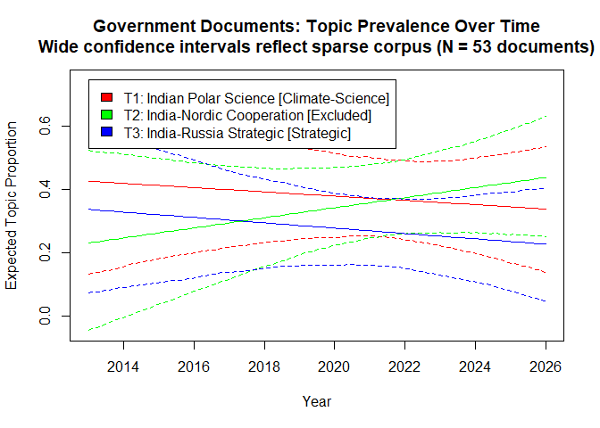<!-- -->

------------------------------------------------------------------------

## 10. Dictionary Validation

``` r
# Theory-driven dictionaries applied to UNSTEMMED public discourse tokens.
# Purpose: validate STM topic interpretations by checking whether
# documents with high STM strategic scores also score high on the
# strategic dictionary, and vice versa for climate-science.

# Strategic framing dictionary, drawn from the theoretical framework
dict_strategic <- dictionary(list(
  strategic = c(
    "geopolit*", "strateg*", "secur*", "sovereig*", "militar*",
    "power", "rival*", "competi*", "dominan*", "influenc*",
    "interest*", "deterren*", "alliance*", "balance*",
    "observer status", "resource*", "energ*", "hydrocarbon*",
    "northern sea route", "relos", "indo-pacific",
    "great power", "china", "russia", "nato",
    "access", "postur*", "logist*", "naval*", "shipping*"
  )
))

# Climate-science framing dictionary, drawn from the theoretical framework
dict_climate <- dictionary(list(
  climate_science = c(
    "climat*", "glacier*", "melt*", "sea ice", "permafrost",
    "warming", "emission*", "carbon*", "monsoon*", "himalay*",
    "temperature*", "precipitation*", "scientific research",
    "himadri", "environment*", "ecosystem*", "biodiversity",
    "ncpor", "arctic science", "atmospheric*", "oceanograph*",
    "polar research", "polar expedition"
  )
))

# Apply dictionaries to unstemmed public discourse tokens
dfm_strategic_val <- dfm_lookup(dfm(prep_pub$toks_raw),
                                dictionary = dict_strategic)
dfm_climate_val   <- dfm_lookup(dfm(prep_pub$toks_raw),
                                dictionary = dict_climate)

# Validation dataframe; dictionary scores normalised by document length
validation <- data.frame(
  year           = corpus_pub$year,
  strategic_dict = as.numeric(dfm_strategic_val[, "strategic"]) /
                   corpus_pub$doc_length,
  climate_dict   = as.numeric(dfm_climate_val[, "climate_science"]) /
                   corpus_pub$doc_length,
  strategic_stm  = theta_pub$strategic_score,
  climate_stm    = theta_pub$climate_score
)

# Correlation between dictionary scores and STM framing scores
r_strategic <- round(cor(validation$strategic_dict, validation$strategic_stm), 3)
r_climate   <- round(cor(validation$climate_dict,   validation$climate_stm),   3)

cat("Validation correlations:\n")
```

    ## Validation correlations:

``` r
cat("Strategic, Dictionary vs STM:", r_strategic, "\n")
```

    ## Strategic, Dictionary vs STM: 0.679

``` r
cat("Climate-Science, Dictionary vs STM:", r_climate, "\n")
```

    ## Climate-Science, Dictionary vs STM: 0.712

``` r
# Scatter plot: strategic validation
p_val_strategic <- ggplot(validation,
       aes(x = strategic_dict, y = strategic_stm)) +
  geom_point(alpha = 0.3, color = "#2166ac", size = 1.5) +
  geom_smooth(method = "lm", color = "#2166ac",
              se = TRUE, linewidth = 0.8) +
  labs(
    title    = "Dictionary Validation: Strategic Framing",
    subtitle = paste0("r = ", r_strategic),
    x        = "Strategic Dictionary Score (normalised by document length)",
    y        = "STM Strategic Framing Score",
    caption  = paste0("Public Discourse corpus (2013-2026) | N = ",
                      nrow(corpus_pub), " documents")
  ) +
  theme_minimal() +
  theme(
    plot.title    = element_text(face = "bold", size = 12),
    plot.subtitle = element_text(size = 10, color = "#2166ac")
  )

print(p_val_strategic)
```

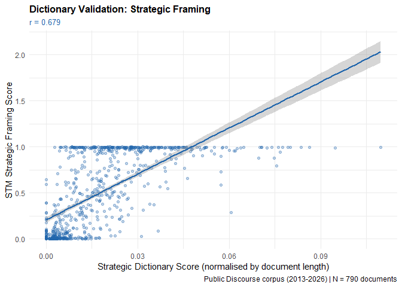<!-- -->

``` r
ggsave(here("figures", "plot4_validation_strategic.png"),
       plot = p_val_strategic, width = 9, height = 6, dpi = 300)

# Scatter plot: climate-science validation
p_val_climate <- ggplot(validation,
       aes(x = climate_dict, y = climate_stm)) +
  geom_point(alpha = 0.3, color = "#1a9850", size = 1.5) +
  geom_smooth(method = "lm", color = "#1a9850",
              se = TRUE, linewidth = 0.8) +
  labs(
    title    = "Dictionary Validation: Climate-Science Framing",
    subtitle = paste0("r = ", r_climate),
    x        = "Climate-Science Dictionary Score (normalised by document length)",
    y        = "STM Climate-Science Framing Score",
    caption  = paste0("Public Discourse corpus (2013-2026) | N = ",
                      nrow(corpus_pub), " documents")
  ) +
  theme_minimal() +
  theme(
    plot.title    = element_text(face = "bold", size = 12),
    plot.subtitle = element_text(size = 10, color = "#1a9850")
  )

print(p_val_climate)
```

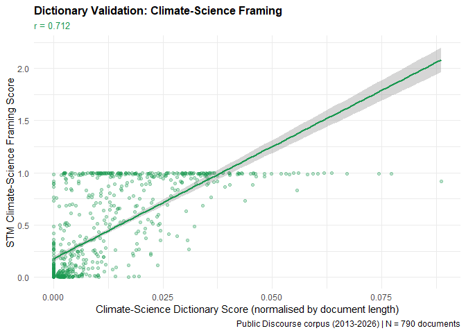<!-- -->

``` r
ggsave(here("figures", "plot5_validation_climate.png"),
       plot = p_val_climate, width = 9, height = 6, dpi = 300)
```

------------------------------------------------------------------------

## Session Info

``` r
sessionInfo()
```

    ## R version 4.5.1 (2025-06-13 ucrt)
    ## Platform: x86_64-w64-mingw32/x64
    ## Running under: Windows 11 x64 (build 26200)
    ## 
    ## Matrix products: default
    ##   LAPACK version 3.12.1
    ## 
    ## locale:
    ## [1] LC_COLLATE=English_India.utf8  LC_CTYPE=English_India.utf8   
    ## [3] LC_MONETARY=English_India.utf8 LC_NUMERIC=C                  
    ## [5] LC_TIME=English_India.utf8    
    ## 
    ## time zone: Asia/Calcutta
    ## tzcode source: internal
    ## 
    ## attached base packages:
    ## [1] stats     graphics  grDevices utils     datasets  methods   base     
    ## 
    ## other attached packages:
    ##  [1] scales_1.4.0              lubridate_1.9.4          
    ##  [3] forcats_1.0.0             dplyr_1.1.4              
    ##  [5] purrr_1.1.0               readr_2.1.5              
    ##  [7] tidyr_1.3.1               tibble_3.3.0             
    ##  [9] ggplot2_4.0.0             tidyverse_2.0.0          
    ## [11] stringr_1.5.1             stm_1.3.8                
    ## [13] quanteda.textplots_0.96   quanteda.textstats_0.97.2
    ## [15] readtext_0.92.1           quanteda_4.3.1           
    ## [17] here_1.0.2               
    ## 
    ## loaded via a namespace (and not attached):
    ##  [1] utf8_1.2.6         generics_0.1.4     slam_0.1-55        stringi_1.8.7     
    ##  [5] lattice_0.22-7     hms_1.1.3          digest_0.6.37      magrittr_2.0.3    
    ##  [9] timechange_0.3.0   evaluate_1.0.5     grid_4.5.1         RColorBrewer_1.1-3
    ## [13] fastmap_1.2.0      rprojroot_2.1.1    Matrix_1.7-3       mgcv_1.9-3        
    ## [17] httr_1.4.7         stopwords_2.3      textshaping_1.0.3  pdftools_3.6.0    
    ## [21] cli_3.6.5          rlang_1.1.6        splines_4.5.1      withr_3.0.2       
    ## [25] yaml_2.3.10        tools_4.5.1        tzdb_0.5.0         fastmatch_1.1-6   
    ## [29] vctrs_0.6.5        R6_2.6.1           matrixStats_1.5.0  lifecycle_1.0.4   
    ## [33] ragg_1.5.0         pkgconfig_2.0.3    pillar_1.11.0      gtable_0.3.6      
    ## [37] data.table_1.17.8  glue_1.8.0         Rcpp_1.1.0         systemfonts_1.2.3 
    ## [41] xfun_0.53          tidyselect_1.2.1   rstudioapi_0.17.1  knitr_1.50        
    ## [45] farver_2.1.2       nlme_3.1-168       SnowballC_0.7.1    htmltools_0.5.8.1 
    ## [49] labeling_0.4.3     rmarkdown_2.29     qpdf_1.4.1         compiler_4.5.1    
    ## [53] S7_0.2.0           nsyllable_1.0.1    askpass_1.2.1
